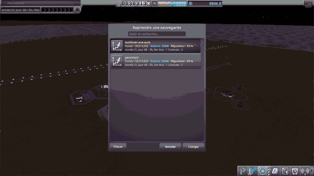
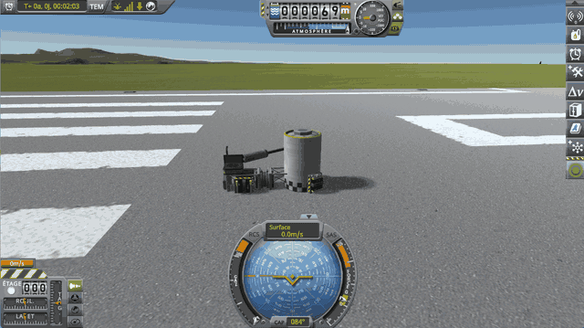

# Suspension Bounce Fix

**⚠️ Not finished yet.** This is a new fix, not a finished mod. The code and the conclusions on this page can still
change.

Un correctif pour KSP 1.12 stock : quelques patchs Harmony, dans huit fichiers source, et un neuvième qui mesure leur
coût. Voici ce qu'il corrige :

> **In KSP, landing legs and wheels often go haywire.** A light probe leaves the runway on its own legs, a landing leg
> set down alone in EVA construction flies off, a light rover that stands still on Kerbin never comes to rest on Eve,
> a heavy rover on the Mun slides down a slope with its brakes on.
> *(FR, à traduire)* Un vaisseau lourd garé freins serrés dérive lentement.

<table>
<tr>
<td width="50%"></td>
<td width="50%"></td>
</tr>
<tr>
<td valign="top"><em>A probe of 100 kg on three LT-05 legs, launched on the runway
(<a href="#a-light-probe-on-the-runway">how</a>).</em></td>
<td valign="top"><em>A rover of a quarter of a ton on four RoveMax S2 wheels, set down on Eve, saved, and loaded
there.</em></td>
</tr>
<tr>
<td></td>
<td></td>
</tr>
<tr>
<td valign="top"><em>On Minmus, a landing leg taken off a lander and set down on its foot in EVA construction
(<a href="#a-landing-leg-placed-alone">how</a>).</em></td>
<td valign="top"><b>⚠️ Only with Terrain Precision Fix:</b> <em>the same on Kerbin. In stock, the leg lies down there
and stays there.</em></td>
</tr>
<tr>
<td></td>
<td></td>
</tr>
<tr>
<td valign="top"><em>A rover of 14 t on six TR-2L wheels, set down on Eve, saved, and loaded there.</em></td>
<td valign="top"><em>A vessel of 400 kg on the runway swings a landing leg on a rotation servo against a fuel tank
(<a href="#a-landing-leg-swung-against-a-fuel-tank">how</a>).</em></td>
</tr>
</table>

*KSP 1.12.5 and KSP Community Fixes, without this mod.*

The cause: KSP sizes a suspension with a few simple rules, patched over the years, and some cases slip through: a
light vessel, a part lying alone, or a heavy rover on light wheels, gets a damper that throws it up instead of slowing
it down; on a light world, a heavy rover gets a spring too soft for it, and sinks to the end of its travel; and a
wheel at the end of its travel hides part of the weight it carries from its tyre, which loses its grip, while the
end-stop holds the vessel in jolts (see [The culprits](#the-culprits)). This mod lowers a damper only as far as those
cases need, with or without [Terrain Precision Fix](https://github.com/lhervier/KSP-Fix-TerrainPrecision), stiffens the
spring of a heavy rover on a light world as it would be on Kerbin, and holds a wheel at the end of its travel itself,
telling its tyre the weight it really carries: every other vessel behaves as without it, give or take a few percent of
damping.

*(FR, à traduire)* Les pneus, eux, ont deux défauts qui ne tiennent pas à la suspension. Sur un vaisseau de plusieurs
pièces, la vitesse que lit chaque pneu contient une vitesse fantôme laissée par les joints : les pneus combattent un
glissement qui n'existe pas, et le vaisseau garé dérive. Et sous 1 m/s, un pneu de VPP ne tient qu'en glissant : il n'a
pas d'adhérence statique, et un rover pivote sur lui-même en s'arrêtant. Le mod donne au pneu la vitesse de sa roue
telle qu'elle a vraiment bougé ; il peut aussi lui donner une adhérence statique, mais ce réglage est désactivé
par défaut (voir les limites).

**How this was made.** The investigation and the code were written with Claude, Anthropic's AI assistant.
Everything here was reviewed and validated by a human — me. I am saying so up front, because contributions made with
an AI deserve a closer look than others, and because some people would rather stop reading here. That look should be
quick: the stock code involved is named and quoted on these pages, and each patch of the fix is quoted and explained
in the page of its culprit.

## The culprits

How KSP 1.12.5 sets the spring and the damper of a suspension: a simple base model, the patches it got for the cases
where it was not enough, then what those patches leave unanswered: what throws a light vessel, or a part placed
alone, into the air, and what makes a rover slide when its wheels reach the end of their travel.
*(FR, à traduire)* Puis deux défauts du pneu lui-même : ce qui fait dériver un vaisseau garé, et ce qui fait pivoter un
rover qui s'arrête, que ce mod ne corrige que si on le lui demande.

### The base model

In KSP, a suspension is a spring and a damper, which KSP sets on its own by four rules. The suspension measures how far
it has sunk with a ray cast along its axis: it works on any surface. The spring follows the weight, shared equally
between the wheels on the ground: every vessel sinks about as far. The damper follows the spring, and so only grows as
the square root of the mass: right for a leg carrying about a ton, softer above that without harm, too stiff below.
Last, the setting only happens on contact: in the air, the wheel keeps its old settings.

**→ Full chapter: [The base model](docs/the-culprits/the-base-model.md)**

### The patches

KSP got several corrections for the cases where this model was not enough. Each has its side effects, and several
make the culprits below:

- **The half-ton floor**: each wheel carries at least the weight of half a ton on Kerbin, so that a very small spring
  is not rounded down to zero; a light vessel then gets the damper of half a ton.
- **Rounding and the write threshold**: the spring is only written when it changes by more than 3, probably against a
  loop between the spring and the compression; a small spring stays at zero, hence the floor.
- **The boost with compression**: the spring stiffens up to three times near the end of its travel, and the damper
  with it, at the moment of impact.
- **The big-vessel correction**: above about forty tons, the damper stiffens up to nearly four times, from the mass of
  the whole vessel, not from what each leg carries.
- **The automatic sliders**: set at the first contact, the damper up to 2 on Eve.
- **High gravity**: above 1.5 g, so on Eve, the spring is tripled and the damper multiplied by 1.2.
- **The gravity curve**: the boost with compression grows at a pace set by a curve of the body's gravity: the whole
  boost on Kerbin, a tenth of it on the Mun, none on Minmus.

**→ Full chapter: [The patches](docs/the-culprits/the-patches.md)**

### Why a damper can throw a vessel

In real life, a damper that is too strong throws nothing: it only makes the leg slow to settle. But KSP works out
physics in small steps, fifty a second. At each step, the damper slows the leg according to the speed it had at the
start of the step, for the whole step. On a loaded leg, this braking takes off a little speed at each step. On a leg
that carries almost nothing, or a light wheel on a light mount, which the damper pushes before the rest of the vessel
follows, it is so strong that in a single step it does more than stop it: it sends it back the other way, faster than
it came. The next step does it again, and in a few steps the vessel leaves at tens of metres per second. Both culprits
lead there.

### First culprit: a damper too strong for a light vessel

Because of the floor, a leg carrying 50 kg gets the damper of a leg carrying half a ton, far too strong for it: it
throws it. A heavy world makes it worse: a small rover that stands still on Kerbin bounces on and on on Eve, and a
heavy rover whose wheels hang from light trusses bounces higher and higher there, until its wheels break. The mod
brings the damper down under a limit.

**→ Full chapter: [First culprit: a damper too strong for a light vessel](docs/the-culprits/a-damper-too-strong-for-a-light-vessel.md)**

### Second culprit: a suspension in the air keeps its old settings

In the air, a wheel keeps the spring and the damper of its last contact. A part placed alone in EVA construction,
which KSP makes weigh up to 20 t for its first seconds, thus keeps a suspension set for 20 t, which throws it when it
touches the ground again at its own mass. The mod brings the damper down under the limit as soon as the wheel is in
the air.

**→ Full chapter: [Second culprit: a suspension in the air keeps its old settings](docs/the-culprits/a-suspension-in-the-air-keeps-its-settings.md)**

### Third culprit: a bottomed wheel hides its weight from the tyres

KSP's tyres go through Vehicle Physics Pro (VPP), which does not weigh the vessel: it reads each wheel's load in the
force of its suspension, and draws from it the tyre's grip, what holds it on a slope and what stops it sliding. When a
wheel reaches its end-stop, as happens on a heavy rover on the Mun, across a slope or with springs set soft, the
end-stop carries the rest of the weight, but its force is reported nowhere: VPP believes the wheel carries less than it
does. And the end-stop only acts at the steps that start with the wheel already past the end of its travel: it holds
the vessel in jolts, one step on, one step off, and the tyres slip at each one. The rover loses the grip that should
hold it back: it slides sideways on flat ground, and goes down a slope, brakes on. VPP is written for a car made of
one rigid body; KSP makes each wheel a vehicle of its own, on its own part. The mod takes the vessel as one body, and
holds the end-stops of its wheels itself, one step ahead: the smallest forces, all wheels together, that keep every
wheel from going past the end of its travel. It applies them to the wheels, and adds them to the force VPP reads.

**→ Full chapter: [Third culprit: a bottomed wheel hides its weight from the tyres](docs/the-culprits/a-bottomed-wheel-hides-its-weight-from-the-tyres.md)**

### Fourth culprit: below 1 g, the automatic spring is too soft

KSP stiffens a suspension's spring as it sinks, but at a pace weighted by a curve of the body's gravity: the whole
boost on Kerbin, a tenth of it on the Mun, none on Minmus. Yet the load the spring is worked out for already follows
gravity: the curve has no physical reason, and below 1 g, it gives a heavy rover's spring much less than it would get
on Kerbin for the same load. On the Mun, its wheels sink down to their end-stops, and the third culprit makes it
slide, brakes on. On the lightest bodies, the half-ton floor protects rovers of reasonable size: the gap is on the
Mun. The mod works out the spring with Kerbin's curve on every lighter body.

**→ Full chapter: [Fourth culprit: below 1 g, the automatic spring is too soft](docs/the-culprits/the-automatic-spring-too-soft-below-1-g.md)**

### Cinquième coupable : le pneu combat un glissement qui n'existe pas

Un vaisseau est fait de pièces reliées par des joints. Quand ces joints portent une charge qui dure, comme le poids
d'un vaisseau garé, la physique les recolle à chaque pas en déplaçant un peu les pièces, puis retire cette correction de
la vitesse qu'elle rend. La vitesse de chaque pièce garde alors un petit écart constant, qui ne déplace rien, de sens
opposés sur des pièces qui se poussent : sur une grue de 33 t posée sur la Mune, +1,3 et −2,9 mm/s sur deux roues qui
avancent pourtant ensemble. VPP lit le glissement du pneu dans cette vitesse : chaque pneu pousse contre un glissement
qui n'existe pas, jusqu'à 99 % de son adhérence, et le vaisseau dérive, freins serrés. Le mod donne au pneu la vitesse
de son contact telle que la roue a vraiment bougé, d'après sa position à ce pas et au pas d'avant.

**→ Chapitre complet : [Cinquième coupable : le pneu combat un glissement qui n'existe pas](docs/the-culprits/a-tyre-fights-a-slide-that-does-not-exist.md)**

### Sixième coupable : le pneu n'a pas d'adhérence statique

Un vrai pneu à l'arrêt tient sans glisser, jusqu'à sa limite d'adhérence. Sous 1 m/s, VPP retient le sien par une force
proportionnelle à sa vitesse de glissement, sans mémoire du chemin parcouru : une force qui dure n'est tenue qu'en
glissant. Freins lâchés, un rover qui s'arrête dans un creux pivote sur lui-même, d'environ un degré par seconde : 8,6°
en 25 s sur Eve. Le mod peut poser sous chaque roue presque au repos un point d'ancrage, et un ressort qui l'y
ramène : le pivot tombe à 0,5°. **Mais ce réglage, `staticGrip`, est désactivé par défaut** : VPP lisse la force du
pneu avant de l'appliquer, plus ou moins lentement selon la pièce, et le ressort agit en retard. Sur la jambe LT-05,
dont le lissage est dix fois plus lent, une sonde légère oscillait sur elle-même sans fin ; le mod lui donne le
lissage des autres roues quand le réglage est activé, mais une roue de mod réglée de même pourrait encore le faire
(voir [Limits](#limits)).

**→ Chapitre complet : [Sixième coupable : le pneu n'a pas d'adhérence statique](docs/the-culprits/a-tyre-has-no-static-grip.md)**

## Checked

Each case has its page: the save it starts from, how to play it by hand, the script that plays it, and what it shows
without and with this mod, with its default settings: the [sixth culprit](docs/the-culprits/a-tyre-has-no-static-grip.md)'s
fix is off. *(FR, à traduire : la phrase précédente est nouvelle.)* The scripts drive KSP through
[KSP-Util-MCPServer](https://github.com/lhervier/KSP-Util-MCPServer), and need nothing but Python 3; their figures
come from [KSP Diag - Suspension](https://github.com/lhervier/KSP-Diag-Suspension) and from `KSP.log`.

### A light probe on the runway

A probe of 100 kg on three LT-05 legs, launched on the runway: without this mod, it leaves the runway the moment
physics starts, and bounces on and on; with it, it settles on its legs within a fraction of a second.

**→ Full chapter: [A light probe on the runway](docs/checked/a-light-probe-on-the-runway.md)**

### A landing leg placed alone

An LT-1 landing leg taken off a lander and set down alone, foot down, in EVA construction: without this mod, it is
thrown into the air on Minmus, and on Kerbin too with Terrain Precision Fix; with it, it tips over onto its side and
comes to rest.

**→ Full chapter: [A landing leg placed alone](docs/checked/a-landing-leg-placed-alone.md)**

### A landing leg swung against a fuel tank

A light vessel swings a landing leg on a rotation servo against the side of a fuel tank: without this mod, it is
thrown sideways, often hard enough to break apart; with it, it is pushed aside at a walking pace.

**→ Full chapter: [A landing leg swung against a fuel tank](docs/checked/a-landing-leg-swung-against-a-fuel-tank.md)**

### A light rover on Eve

A rover of a quarter of a ton on four RoveMax S2 wheels, loaded on Eve: without this mod, it bounces higher and
higher and breaks a wheel; with it, it stays on its wheels.

**→ Full chapter: [A light rover on Eve](docs/checked/a-light-rover-on-eve.md)**

### A heavy rover on Eve

A rover of 10 t, and the same with a blade of 3.5 t, on six TR-2L wheels at the end of trusses, loaded on Eve:
without this mod, it hops and breaks its wheels; with it, it stays on its wheels.

**→ Full chapter: [A heavy rover on Eve](docs/checked/a-heavy-rover-on-eve.md)**

### A rover lowered onto its wheels on Eve

A base of 5 t on six TR-2L wheels, lowered onto them by its hinges on Eve: without this mod, its wheels kick it up
as they touch, unless its springs are set by hand; with it, it settles with its springs left to the game.

**→ Full chapter: [A rover lowered onto its wheels on Eve](docs/checked/a-rover-lowered-onto-its-wheels-on-eve.md)**

### A rover on its end-stops

A rover whose springs are set soft, on Kerbin: its wheels rest on their end-stops. Without this mod, its tyres read a
fraction of its weight: it slides sideways on flat ground, and slides down a slope, brakes on; with it, the tyres read
the whole weight, and it holds.

**→ Full chapter: [A rover on its end-stops](docs/checked/a-rover-on-its-end-stops.md)**

### A lander dropped onto its end-stops

A lander on four LT-1 legs, its springs set soft, dropped from its launch clamps onto the runway: it comes to rest on
its end-stops. Without this mod, its feet read none of its weight, and it slowly turns and slides; with it, it stays
still. With this mod, it bounces back up faster from the fall.

**→ Full chapter: [A lander dropped onto its end-stops](docs/checked/a-lander-dropped-onto-its-end-stops.md)**

### A heavy rover on Kerbin, the Mun and Minmus

The same rover of 10 t, its springs left to the game, on three worlds: without this mod, it sinks to three quarters
of its travel on Kerbin, to half of it on Minmus, and to the end of it on the Mun, where it slides down a slope, brakes
on; with it, it stays clear of its end-stops on the Mun, and holds.

**→ Full chapter: [A heavy rover on Kerbin, the Mun and Minmus](docs/checked/a-heavy-rover-on-kerbin-the-mun-and-minmus.md)**

### A rover driving in a straight line

A rover set off from standstill on flat ground, throttle held, its steering let go: not a culprit, a check that this
mod does not make a rover turn on its own. Set off from the same place, it keeps its line within a degree in 30 s,
with or without this mod.

**→ Full chapter: [A rover driving in a straight line](docs/checked/a-rover-driving-in-a-straight-line.md)**

## Performance

The mod works at every physics step, on every wheel of every vessel in flight. Timed by its own measure
(`measureCost = true` in its `settings.cfg`, off by default and then not installed at all) and by KSPProfiler, against
the same scenarios without the fixes: a rover driving on flat ground pays about 0.02 ms more per physics step, which
no frame shows; the dearest case found, a crane of 112 parts resting on its end-stops, about 0.14 ms more per physics
step, or about 0.05 ms per frame.

**→ Full chapter: [Performance](docs/performance.md)**

## Limits

- **A wheel landing hard enough to cross its whole travel in a single physics step still meets the game's end-stop.**
  The mod holds an end-stop one step ahead; a wheel that goes from the top of its travel to past the end of it within
  one step is caught by the game's end-stop, as without this mod, and held by the mod from the next step on.
- **On a low gravity body, a leg placed alone still hops a little.** Its spring is still the spring of half a ton,
  about 200 times its weight on Minmus: it pushes the leg off the ground as it straightens, and the leg falls back
  slowly. Removing that hop would mean lowering the floor of the spring, which this fix does not do.
- **Without Terrain Precision Fix, a wheel placed alone in EVA construction can jump a few seconds after being
  placed**, for another reason: `ModuleCargoPart.MakePartSettle` makes a part placed alone weigh 4 t (20 t below
  0.8 g) for 3 s, and the suspension sizes its spring for that. This fix does not change it: Terrain Precision Fix's
  `fixLonePartMass` does.

- **Springs and dampers set by hand stay as the player set them.** Players often set them by hand to work around the
  bounce, springs at their stiffest for instance. The mod sizes the damper and the spring from those settings, not
  instead of them: with stiff springs set by hand, a rover settles about as it does without this mod; with springs
  set very soft, its wheels rest on their end-stops and it can hop again. For the best result, switch springs and
  dampers back to automatic in the wheel's window.
- **A heavy rover can still shift a little as it settles after loading.** The rover of 10 t of
  [A heavy rover on Eve](docs/checked/a-heavy-rover-on-eve.md), brakes on, moved about 7 cm and turned about 1° in
  the seconds after Parking Brake let it go, then held still (a few thousandths of a millimetre per second). That
  first settling comes from another bug, still to fix.
  *(FR) Remesuré le 2026-11-10 après-midi, Parking Brake desserré : 1 à 2 cm et 0,05 à 0,2° dans les secondes qui
  suivent, puis immobile (0,001 mm/s). Une fois sur deux, la sauvegarde s'est
  chargée Parking Brake serré, et le rover a glissé de 12 cm pendant qu'il le tenait. Chiffres anglais à corriger à la
  traduction.*
- *(FR, à traduire)* **Un rover freins lâchés pivote encore sur lui-même quand il s'arrête de lui-même**, sur une
  pente ou dans un creux : environ un degré par seconde pendant l'arrêt, 8,6° en 25 s pour le rover lourd d'Eve. Garé,
  un vaisseau lourd peut aussi tourner très lentement : 0,12° par minute pour le même rover, freins serrés. C'est le
  [sixième coupable](docs/the-culprits/a-tyre-has-no-static-grip.md) : le pneu de VPP, la bibliothèque de roues de KSP,
  n'a pas d'adhérence statique. **Le mod sait le corriger, mais ne le fait pas par défaut** : avec
  `staticGrip = true` dans `settings.cfg`, un ressort retient chaque roue là où elle s'est arrêtée, et le pivot tombe
  à 0,5°. Mais VPP lisse la force du pneu avant de l'appliquer, différemment pour chaque roue : ce ressort en retard
  faisait osciller sans fin une sonde légère sur trois jambes LT-05, dont le lissage est dix fois plus lent. Le mod
  donne à la LT-05 celui des autres roues quand le réglage est activé ; une roue de mod au lissage aussi lent pourrait
  encore osciller. Aucune raideur n'est sûre pour toutes les roues. À activer en connaissance de cause ; sinon, serrer les freins, ou Parking Brake, reste
  le moyen de garer un rover.

## Work in progress

- **Other parts with a suspension.** The fix applies to every part with `ModuleWheelSuspension`: landing legs, wheels
  and landing gear. It has been played with LT-05 and LT-1 legs, and RoveMax S2 and TR-2L wheels only.
- **A rover resting on a broken wheel.** The game turns a broken wheel off: no spring, no damper, no tyre, and its hub
  rests on the ground as any other part does. The mod leaves it out when it shares the vessel's weight among the
  wheels. Brakes on and Parking Brake released, the rover of
  [A light rover on Eve](docs/checked/a-light-rover-on-eve.md) holds on its four wheels; with one of them broken
  ([diag/SuspensionBounceLightRoverEveBrokenWheel.sfs](diag/SuspensionBounceLightRoverEveBrokenWheel.sfs)), it still
  slides a few millimetres per second and turns about 3° a minute. Why is not known yet.

## Installing

Requires [HarmonyKSP](https://github.com/KSPModdingLibs/HarmonyKSP) (`GameData/000_Harmony`). Copy
`GameData/KSPFixSuspensionBounce` into the `GameData` folder of KSP.

## Building

Set `KSPDIR` to your KSP install folder, then run `build.bat`: it compiles
`GameData/KSPFixSuspensionBounce/KSPFixSuspensionBounce.dll`.

## License

MIT, see [LICENSE](LICENSE).
