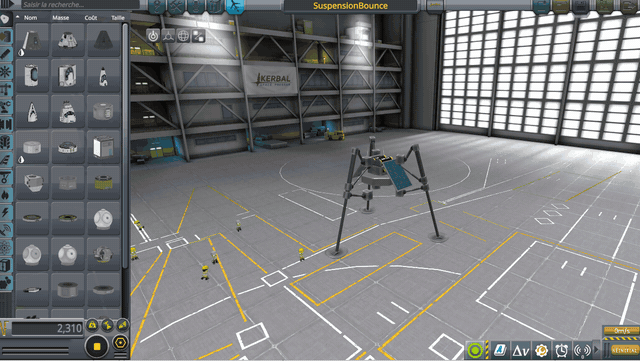
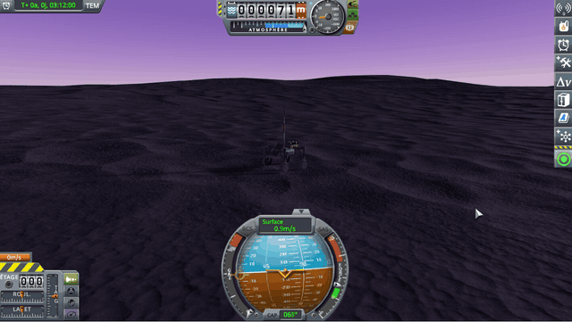
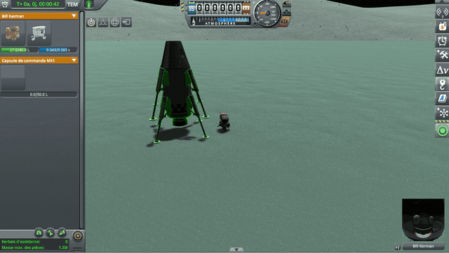
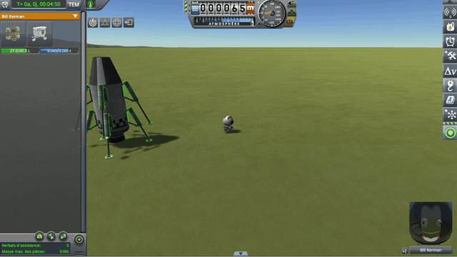

# Suspension Bounce Fix

**⚠️ Not finished yet.** This is a new fix, not a finished mod. The code and the conclusions on this page can still
change.

A fix for stock KSP 1.12, kept small: two Harmony postfixes, in two short source files. Here is what it fixes:

> **In KSP, landing legs and wheels often go haywire.** A light probe leaves the runway on its own legs, a landing leg
> set down alone in EVA construction flies off, a light rover that stands still on Kerbin never comes to rest on Eve.

<table>
<tr>
<td width="50%"></td>
<td width="50%"></td>
</tr>
<tr>
<td valign="top"><em>A probe of 100 kg on three LT-05 legs, launched on the runway
(<a href="#a-light-probe-on-the-runway">how</a>).</em></td>
<td valign="top"><em>A rover of a quarter of a ton on four RoveMax S2 wheels, set down on Eve, saved, and loaded
there.</em></td>
</tr>
<tr>
<td></td>
<td></td>
</tr>
<tr>
<td valign="top"><em>On Minmus, a landing leg taken off a lander and set down on its foot in EVA construction
(<a href="#a-landing-leg-placed-alone">how</a>).</em></td>
<td valign="top"><b>⚠️ Only with Terrain Precision Fix:</b> <em>the same on Kerbin. In stock, the leg lies down there
and stays there.</em></td>
</tr>
</table>

*KSP 1.12.5 and KSP Community Fixes, without this mod.*

The cause: KSP sizes a suspension with a few simple rules, patched over the years, and some cases slip through: a
light vessel, or a part lying alone, gets a damper that throws it up instead of slowing it down (see
[The culprits](#the-culprits)). This mod only changes a suspension in those cases, with or without
[Terrain Precision Fix](https://github.com/lhervier/KSP-Fix-TerrainPrecision): every other vessel behaves as without
it.

**How this was made.** The investigation and the code were written with Claude, Anthropic's AI assistant.
Everything here was reviewed and validated by a human — me. I am saying so up front, because contributions made with
an AI deserve a closer look than others, and because some people would rather stop reading here. That look should be
quick: the stock code involved is named and quoted on this page, and the fix is two postfixes you can read in a
few minutes.

## The culprits

How KSP 1.12.5 sets the spring and the damper of a suspension: a simple base model, the patches it got for the cases
where it was not enough, then what those patches leave unanswered, and what throws a light vessel, or a part placed
alone, into the air.

### The base model

In KSP, a suspension is a spring and a damper, which KSP sets on its own by four rules. The suspension measures how far
it has sunk with a ray cast along its axis: it works on any surface. The spring follows the weight, shared equally
between the wheels on the ground: every vessel sinks about as far. The damper follows the spring, and so only grows as
the square root of the mass: right for a leg carrying about a ton, softer above that without harm, too stiff below.
Last, the setting only happens on contact: in the air, the wheel keeps its old settings.

**→ Full chapter: [The base model](docs/the-culprits/the-base-model.md)**

### The patches

KSP got several corrections for the cases where this model was not enough. Each has its side effects, and several
make the culprits below:

- **The half-ton floor**: each wheel carries at least the weight of half a ton on Kerbin, so that a very small spring
  is not rounded down to zero; a light vessel then gets the damper of half a ton.
- **Rounding and the write threshold**: the spring is only written when it changes by more than 3, probably against a
  loop between the spring and the compression; a small spring stays at zero, hence the floor.
- **The boost with compression**: the spring stiffens up to three times near the end of its travel, and the damper
  with it, at the moment of impact.
- **The big-vessel correction**: above about forty tons, the damper stiffens up to nearly four times, from the mass of
  the whole vessel, not from what each leg carries.
- **The automatic sliders**: set at the first contact, the damper up to 2 on Eve.
- **High gravity**: above 1.5 g, so on Eve, the spring is tripled and the damper multiplied by 1.2.

**→ Full chapter: [The patches](docs/the-culprits/the-patches.md)**

### Why a damper can throw a vessel

In real life, a damper that is too strong throws nothing: it only makes the leg slow to settle. But KSP works out
physics in small steps, fifty a second. At each step, the damper slows the leg according to the speed it had at the
previous step. On a loaded leg, this braking takes off a little speed at each step. On a leg that carries almost
nothing, it is so strong that in a single step it does more than stop it: it sends it back the other way, faster than
it came. The next step does it again, and in a few steps the vessel leaves at tens of metres per second. Both culprits
lead there.

### First culprit: a damper too strong for a light vessel

Because of the floor, a leg carrying 50 kg gets the damper of a leg carrying half a ton, far too strong for it: it
throws it. A heavy world makes it worse: a small rover that stands still on Kerbin bounces on and on on Eve. The mod
brings the damper down under a limit.

**→ Full chapter: [First culprit: a damper too strong for a light vessel](docs/the-culprits/a-damper-too-strong-for-a-light-vessel.md)**

### Second culprit: a suspension in the air keeps its old settings

In the air, a wheel keeps the spring and the damper of its last contact. A part placed alone in EVA construction,
which KSP makes weigh up to 20 t for its first seconds, thus keeps a suspension set for 20 t, which throws it when it
touches the ground again at its own mass. The mod brings the damper down under the limit as soon as the wheel is in
the air.

**→ Full chapter: [Second culprit: a suspension in the air keeps its old settings](docs/the-culprits/a-suspension-in-the-air-keeps-its-settings.md)**

## Checked

### A light probe on the runway

KSP 1.12.5 with KSP Community Fixes. The probe is [diag/SuspensionBounce.craft](diag/SuspensionBounce.craft): an
OKTO2 probe core, three LT-05 micro landing struts, a Z-100 battery and two OX-STAT solar panels, about 100 kg in all,
so about 33 kg per leg. Copy it into `Ships/SPH` of a sandbox game and launch it on the runway.

Without this mod, the probe leaves the runway the moment physics starts: the altimeter, which reads 70 m on the
runway, goes above 230 m, then the probe falls back, bounces up again, and so on. Putting it back on the ground by any
other means (the *Set Position* tool of the debug menu, for one) ends the same way. With this mod, the probe settles
on its legs within a fraction of a second, and stays there.

With `logLevel = Debug` in the settings, the mod writes a line for each leg whose damper it lowers:

```
[KSPFixSuspensionBounce] [DEBUG] Damper of miniLandingLeg (749513586) of SuspensionBounce limited to 0.833 for 0.033 t carried, KSP computed 7
```

### A landing leg placed alone

The same damper throws a landing leg put down alone in EVA construction, but stock hides it most of the time:
`ModuleCargoPart.MakePartSettle` makes a part placed alone weigh 4 t for its first 3 s on the ground, 20 t below
0.8 g. Under that weight, the damper is no longer too stiff, and the leg simply tips over onto its flat side, its
foot, where its suspension is, off the ground. When its own mass comes back:

- on Kerbin, the leg is lying still, and stays there;
- on Minmus, it is still rolling: its foot touches the ground again, and the damper throws it.

[Terrain Precision Fix](https://github.com/lhervier/KSP-Fix-TerrainPrecision), with its `fixLonePartMass` setting
on, gives the part its own mass from the start: its foot is on the ground, and the damper throws it at once, on
Kerbin too. In a sandbox game, with an engineer on EVA next to a lander that has LT-1 landing legs:

1. Open the EVA construction panel and pick the *Place* tool.
2. Click one of the lander's legs that does not touch the ground: it is now held.
3. Click on the ground, foot down.

Without this mod, in stock, the leg tips over onto its side; on Minmus, it leaves the ground a few seconds later and
climbs tens of metres. With Terrain Precision Fix, the leg leaves the ground within a fraction of a second, spinning:
on Kerbin, it rises a few metres and is destroyed when it lands (`landingLeg1 (…) Exploded!!` in `KSP.log`); on
Minmus, it goes much higher. With this mod, with or without Terrain Precision Fix, the leg tips over onto its side,
as a leg standing on its foot would, and may roll or stand up again before it comes to rest; the mod writes:

```
[KSPFixSuspensionBounce] [DEBUG] Damper of landingLeg1 (1927183636) of Jambes d'atterrissage LT-1 limited to 0.793 for 0.037 t carried, KSP computed 6
```

## Limits

- **On a low gravity body, a leg placed alone still hops a little.** Its spring is still the spring of half a ton,
  about 200 times its weight on Minmus: it pushes the leg off the ground as it straightens, and the leg falls back
  slowly. Removing that hop would mean lowering the floor of the spring, which this fix does not do.
- **Without Terrain Precision Fix, a wheel placed alone in EVA construction can jump a few seconds after being
  placed**, for another reason: `ModuleCargoPart.MakePartSettle` makes a part placed alone weigh 4 t (20 t below
  0.8 g) for 3 s, and the suspension sizes its spring for that. This fix does not change it: Terrain Precision Fix's
  `fixLonePartMass` does.
- **A part placed alone that rolls against another vessel can still be pushed off at a few metres per second.** When
  its suspension's ray grazes the small, curved colliders of a lander, an engine bell for one, the point it hits jumps
  from one step to the next, and so does the spring's push. A light part rolls away at 2 to 3 m/s; the ground, broad
  and smooth, does not do this.

## Work in progress

- **Other parts with a suspension.** The fix applies to every part with `ModuleWheelSuspension`: landing legs, wheels
  and landing gear. It has been played with LT-05 and LT-1 legs and RoveMax M1 wheels only.

## Installing

Requires [HarmonyKSP](https://github.com/KSPModdingLibs/HarmonyKSP) (`GameData/000_Harmony`). Copy
`GameData/KSPFixSuspensionBounce` into the `GameData` folder of KSP.

## Building

Set `KSPDIR` to your KSP install folder, then run `build.bat`: it compiles
`GameData/KSPFixSuspensionBounce/KSPFixSuspensionBounce.dll`.

## License

MIT, see [LICENSE](LICENSE).
