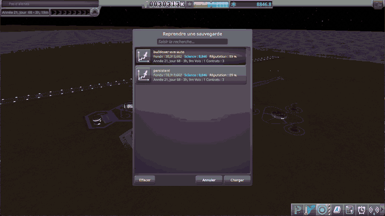

# Damper Bounce

Part of [Suspension Bounce Fix](../README.md): a fix of how a suspension's damper is sized. Here is what it fixes:

> **In KSP, heavy rovers on light wheel mounts, and landing legs set down alone, bounce off the ground.** A heavy
> rover on Eve hops until its wheels break, a base lowered onto its wheels by its hinges is kicked up as they touch,
> and a landing leg set down alone in EVA construction flies off.



*KSP 1.12.5, KSP Community Fixes and KSP-Mod-Bulldozer, without this mod: the bulldozer of
[A heavy rover on Eve](checked/a-heavy-rover-on-eve.md), 14 t on six TR-2L wheels, set down on Eve, saved, and loaded
there. The other cases are shown in
[A damper too strong for what it moves in a step](a-damper-too-strong-for-what-it-moves.md).*

The cause: within a physics step, a suspension's damper only moves its leg and the part it hangs from, not the mass it
was sized for, and a damper right for the vessel can send them back faster than they came; and KSP only sets a damper
while its wheel touches something (see [The culprits](#the-culprits)).

## Why it matters

In real life, a damper that is too strong throws nothing: it only makes the leg slow to settle. But KSP works out
physics in small steps, fifty a second. At each step, the damper slows the leg according to the speed it had at the
start of the step, for the whole step. On a loaded leg, this braking takes off a little speed at each step. On a leg
much lighter than what its damper was sized for, or a light wheel on a light mount, which the damper pushes before the
rest of the vessel follows, it is so strong that in a single step it does more than stop it: it sends it back the
other way, faster than it came. The next step does it again, and in a few steps the vessel leaves at tens of metres
per second. The culprits below lead there.

## The culprits

### A damper too strong for what it moves in a step

The player's setting ([Fixed Tuning](../fixed-tuning/README.md)) sizes a damper for the mass its suspension was set to
carry. Within a step, though, the damper only moves the leg and the part it hangs from. A wheel at the end of a light
truss, under a heavy rover on Eve, is far lighter than the share it carries; a landing leg set down alone keeps the
setting of the lander it was taken from. Either way, a damper right for the vessel throws what it moves.

**→ Full chapter: [A damper too strong for what it moves in a step](a-damper-too-strong-for-what-it-moves.md)**

### The one-step delay

KSP only sets a suspension's spring and damper while its wheel touches something
([the base model](../how-ksp-sets-a-suspension/the-base-model.md)): `ModuleWheelSuspension.FixedUpdate` calls
`SuspensionSpringUpdate` only for a grounded wheel.

```csharp
if (HighLogic.LoadedSceneIsFlight && baseSetup && !base.part.packed && wheel != null && wheel.IsGrounded)
{
    vesselMass = (float)base.vessel.totalMass;
    SuspensionSpringUpdate(vesselMass);
}
```

In the air, the wheel keeps the damper it had at its last step on the ground. At the first step of the next contact,
the physics pushes with that damper, before the game sets a new one: a lander that has burnt most of its fuel since
its last contact touches down with a damper sized for its full tanks. The same holds for whatever writes a damper
only on the ground: a damper bounded on the ground but left as it is in the air hits at the first contact, a step
before the bound comes back.

## Checking the culprit

Each case has its page: the save it starts from, how to play it by hand, the script that plays it, and what it shows
without and with this mod. They were played with Terrain Precision Fix, KSP-Fix-AutoStrut and
[Physics Easing Fix](https://github.com/lhervier/KSP-Fix-PhysicsEasing), without Parking Brake, which this mod is not
compatible with ([Installing](../README.md#installing)): without this mod, then with its default settings, then again
with Fixed Tuning alone (`damperBounce = false` and `endStopSlide = false` in its `settings.cfg`), which shows that
this fix does the work. The cases that the player's setting cures on its own are in
[Fixed Tuning](../fixed-tuning/README.md#checking-the-culprit).

The saves were made, and the cases played, with KSP's terrain detail on *High* (*Settings*, *Graphics*): loaded at
another detail, a save puts its vessel on a ground a little off.

### A landing leg placed alone

An LT-1 landing leg taken off a lander and set down alone, foot down, in EVA construction on Kerbin, with Terrain
Precision Fix and Physics Easing Fix: without this mod, it is thrown into the air about one time in two; with Fixed
Tuning alone, it still is; with this mod, it tips over onto its side and comes to rest, ten times out of ten.

**→ Full chapter: [A landing leg placed alone](checked/a-landing-leg-placed-alone.md)**

### A heavy rover on Eve

A rover of 14 t on six TR-2L wheels at the end of trusses, and the same with a blade of 3.5 t in place of one of its
three ore tanks, loaded on Eve: without this mod, and with Fixed Tuning alone, it hops and breaks its wheels; with this
mod, it stays on its wheels.

**→ Full chapter: [A heavy rover on Eve](checked/a-heavy-rover-on-eve.md)**

### A rover lowered onto its wheels on Eve

A base of 5 t on six TR-2L wheels, lowered onto them by its hinges on Eve: without this mod, its wheels kick it up
as they touch, unless its springs are set by hand; with Fixed Tuning alone, it is still moving at the end of two
trials out of three; with this mod, it settles.

**→ Full chapter: [A rover lowered onto its wheels on Eve](checked/a-rover-lowered-onto-its-wheels-on-eve.md)**

## The fix

The mod bounds the damper of every suspension, at every physics step, its wheel on the ground or in the air, twice
over:

- **For the vessel.** The damper may take off at most half the speed of the mass it slows in a step: c ≤ m / (2 dt),
  dt the physics step. m is the vessel's mass shared among the wheels that brake it together: those on the ground, or,
  in the air, all its suspensions, the share each will carry once they all touch. When it is smaller, m is the mass
  the vessel answers with at the contact ([Vessel Bodies](../vessel-bodies/README.md#the-mass-at-a-contact-inertia-not-load)):
  pushed far from its centre of mass, the vessel turns as much as it rises, and sets less of its mass in motion. That
  mass is the vessel's inertia, not the weight the leg carries: it can always be worked out, and another support can
  only raise it. No more than half: a damper that stopped the leg in one step would already be on the edge, and the
  margin covers joints that give.
- **For the leg itself.** Within a step, the damper moves the leg and the part it is attached to. KSP applies the
  braking worked out from the speed at the start of the step for the whole step; the mod sizes it from the speed at
  the end of the step instead: c / (1 + c × dt / m), c the suspension's damper, dt the step, m the leg and its parent.
  Such a damper can stop them, never send them back, however strong c is. Far from that edge, it is c, give or take a
  few percent.

In the air too: the damper on the wheel is already bounded at the first step of a contact
([the one-step delay](#the-one-step-delay)).

**With the player's setting** ([Fixed Tuning](../fixed-tuning/README.md)), the damper no longer comes from KSP's
spring: it comes from the damping ratio and the mass the suspension was set to carry, with no floor. Fixed Tuning
writes the damper that the bound for the leg itself turns into the damping ratio asked for; where the leg and its
parent are too light for that, it stops at 90 % of the most a step can take for them, m / dt. The bound for the vessel
stays as above.

The `damperBounce` setting of the mod's `settings.cfg` file turns this fix off. **This fix is not supported with
`fixedTuning = false`.**

### In the mod's code

Everything is in [Src/DamperBounce/DamperBounce.cs](../Src/DamperBounce/DamperBounce.cs). On the ground, a postfix of
`ModuleWheelSuspension.SuspensionSpringUpdate`, which KSP calls at every step where the wheel touches something
(`SuspensionSpringUpdatePostfix`): the share is the vessel's mass shared between the wheels on the ground, counted
once per vessel and per step (`Count`) in the read of the wheels' contacts that both fixes share
([Vessel Bodies](../vessel-bodies/README.md#one-read-of-the-wheels-contacts-per-vessel-and-per-step)); `Apply` starts
from the damper in the module's `damper` field:

```csharp
float share = (float)vessel.totalMass / Mathf.Max(count.Grounded, 1);
Apply(__instance, wheel, share, StockDamper(__instance), false);
```

In the air, a postfix of `ModuleWheelSuspension.FixedUpdate`, which KSP calls at every step (`FixedUpdatePostfix`).
It leaves a wheel that touches something to the postfix above, and a part on rails (`packed`) to KSP:

```csharp
if (!HighLogic.LoadedSceneIsFlight || wheel == null || wheel.wheelCollider == null || vessel == null ||
    __instance.part == null || __instance.part.packed || wheel.IsGrounded)
{
    return;
}
```

The share is then the vessel's mass shared between all its suspensions:

```csharp
float share = (float)vessel.totalMass / Mathf.Max(count.All, 1);
Apply(__instance, wheel, share, StockDamper(__instance), true);
```

With the player's setting, a prefix in [Src/FixedTuning/FixedTuning.cs](../Src/FixedTuning/FixedTuning.cs) skips `SuspensionSpringUpdate`
for a suspension that has a setting, but the postfix above still runs: Harmony runs the postfixes of a method whose
prefix skips it. The damper it starts from is then the one `FixedTuning` writes at each step in the module's `damper`
field, worked out backwards from the bound for the leg (`FixedTuning.Damper`, `share` the mass the suspension was set
to carry, `ImplicitCeiling` 0.9):

```csharp
double aimed = 2.0 * damping * Math.Sqrt(Math.Max(spring, 0f) * Math.Max(share, 0f));
...
double most = movedMass / dt;
if (aimed >= ImplicitCeiling * most)
{
    aimed = ImplicitCeiling * most;
    capped = true;
}
damper = aimed / (1.0 - aimed * dt / movedMass);
```

In `Apply`, the share is capped by the mass the vessel answers with at the point of contact (`hit.point`), along the
normal of the surface (`hit.normal`), the contact as the same read gives it (`Contact`), or at the wheel along the
local vertical when it touches nothing, from the read of [Vessel Bodies](../vessel-bodies/README.md):

```csharp
share = Mathf.Min(share, (float)inertia.EffectiveMass(point, normal));
```

Then the bound is the lower of the two: half the share's speed in a step, and the damper taken from the speed at the
end of the step, for the leg and the body its joint attaches it to (`MovedMass`: the leg's rigidbody and
`attachJoint.Joint.connectedBody`, the joint's own body, so that a parent without physics hands it on to its own
parent):

```csharp
float limit = share / (2f * Time.fixedDeltaTime);
float movedMass = MovedMass(suspension.part);
if (movedMass > 0f)
{
    limit = Mathf.Min(limit, stockDamper / (1f + stockDamper * Time.fixedDeltaTime / movedMass));
}
bool isLimited = damper > limit;
```

The mod only writes on the wheel what it changes, and once more at the step where it stops changing it: KSP itself only
writes a damper that differs from the wheel's by more than 1.05
([rounding and the write threshold](../how-ksp-sets-a-suspension/the-patches.md#rounding-and-the-write-threshold)),
and would otherwise keep the mod's:

```csharp
if (isLimited || wasLimited)
{
    wheel.wheelCollider.damperRate = damper;
}
```

In the air, a bounded suspension stays marked as such, so that at the next contact, if KSP's damper no longer needs
bounding, the mod writes it on the wheel in place of its own:

```csharp
else if (offGround)
{
    // Off the ground, the damper on the wheel is not the game's: one lowered earlier stays marked, so that
    // the game's own damper is set back at the next contact.
    wasLimited = false;
}
```

With `logLevel = Debug` in the settings, the mod writes a line each time a suspension's damper starts or stops being
bounded: [A landing leg placed alone](checked/a-landing-leg-placed-alone.md) quotes one.

### Limits

- **A heavy rover can still shift a little as it settles after loading.** The rovers of 14 t of
  [A heavy rover on Eve](checked/a-heavy-rover-on-eve.md), brakes on, turned up to 1.2° in the 30 s after loading,
  and still moved at up to 3 mm/s over the last 10 s. That first settling comes from another bug.

## Work in progress

- **Other parts with a suspension.** The fix applies to every part with `ModuleWheelSuspension`: landing legs, wheels
  and landing gear. It has been played with LT-05, LT-1 and LT-2 legs, and RoveMax S2 and TR-2L wheels only.
