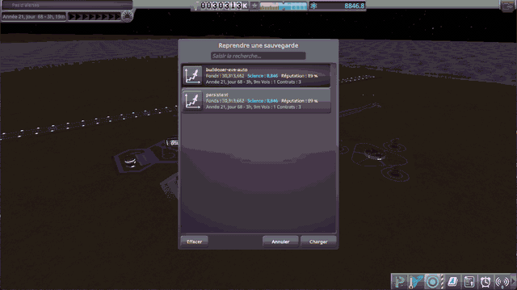
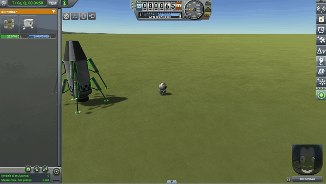

# A damper too strong for what it moves in a step

Part of [Suspension Bounce Fix](../README.md), [Damper Bounce](README.md#the-culprits): a culprit that the player's
setting leaves in place.

With the player's setting ([Fixed Tuning](../fixed-tuning/README.md)), a suspension's damper is sized for the mass it
was set to carry: 2 ζ √(k m), ζ the damping ratio, k the spring, m that mass. It is right for that mass, once the whole
vessel follows. But within a physics step, the damper does not move that mass: it moves the leg and the part the leg
hangs from, and the rest of the vessel follows a step later (see [why a damper can throw a vessel](README.md#why-it-matters)).
When they weigh much less than what the damper was sized for, it is far too strong for them, and sends them back
faster than they came. Two kinds of vessels meet it.

## A wheel on a light mount

A rover of 14 t on six TR-2L wheels, each at the end of a truss, set down on Eve: each wheel carries about 2.3 t, and
gets a damper sized for it. Within a step, that damper moves a wheel and its 375 kg truss, half a ton: far too strong
for them. Without this mod, KSP's own damper, sized from the spring of that wheel on Eve, does the same. With the
player's setting alone, the rover still hops and breaks its wheels
([A heavy rover on Eve](checked/a-heavy-rover-on-eve.md)); a base of 5 t lowered onto the same wheels by its hinges
does not come to rest ([A rover lowered onto its wheels on Eve](checked/a-rover-lowered-onto-its-wheels-on-eve.md)).

*KSP 1.12.5, KSP Community Fixes and KSP-Mod-Bulldozer, without this mod: the bulldozer of
[A heavy rover on Eve](checked/a-heavy-rover-on-eve.md), 14 t on six TR-2L wheels, set down on Eve, saved, and loaded
there.*

## A part set for another vessel

A setting stays with its part: nothing changes it behind the player's back, not even the part leaving its vessel. A
landing leg taken off a lander in EVA construction keeps the setting it had there, sized for its share of the lander,
nearly half a ton. Set down alone, the leg weighs 50 kg: its damper, sized for ten times its mass, throws it, as the
game's own damper does without this mod
([a damper too strong for a light vessel](../fixed-tuning/a-damper-too-strong-for-a-light-vessel.md)).

It only shows once the leg has its own mass: in stock, `ModuleCargoPart.MakePartSettle` makes a part placed alone
weigh 4 t, or 20 t below 0.8 g, for its first 3 s on the ground.
[Terrain Precision Fix](https://github.com/lhervier/KSP-Fix-TerrainPrecision), which this mod requires, gives it its
own mass from the start.

*KSP 1.12.5, KSP Community Fixes and Terrain Precision Fix, without this mod: on Kerbin, the save
[`landing-leg-kerbin.sfs`](https://github.com/lhervier/KSP-Fix-TerrainPrecision/blob/main/diag/lone-parts/limits/landing-leg/landing-leg-kerbin.sfs)
of Terrain Precision Fix; in EVA construction, Bill Kerman takes a leg off the lander and sets it down on its foot
([A landing leg placed alone](checked/a-landing-leg-placed-alone.md)).*

## What bounds it

This fix sizes each damper for what it moves within a step, the leg and the part it hangs from, as well as for the
vessel: [The fix](README.md#the-fix).
