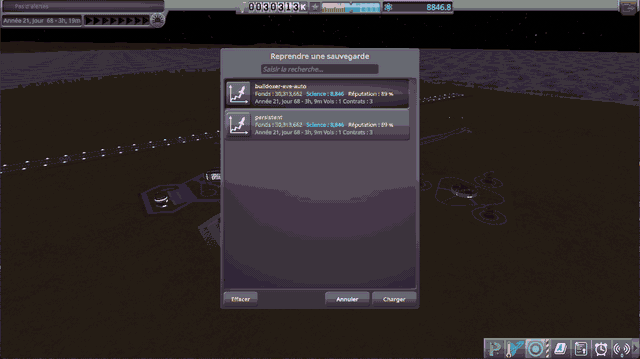
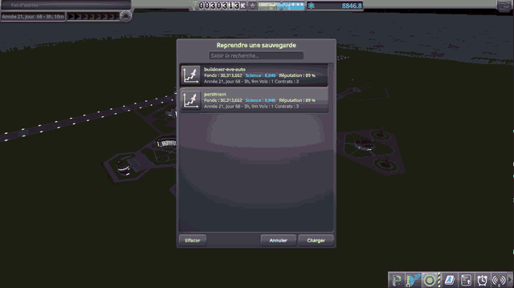

# A heavy rover on Eve

Part of [Suspension Bounce Fix](../../README.md), [Damper Bounce](../README.md#checking-the-culprit):
[a damper too strong for what it moves in a step](../a-damper-too-strong-for-what-it-moves.md), here a heavy
rover whose wheels hang from light trusses.

## The saves

Two saves of the same rover, at rest on Eve: a Mk2 lander can, three ore tanks, six TR-2L wheels each at the end of a
truss, 26 parts. Its suspensions were never set: without this mod, the game sets them; with it, the mod sets them as
the save loads, from the rover's mass shared equally among its wheels
([Suspensions never set](../../fixed-tuning/README.md#suspensions-never-set)). Copy the saves into the folder of a
sandbox game, under `saves`.

- [saves/SuspensionBounceHeavyRoverEve.sfs](../saves/SuspensionBounceHeavyRoverEve.sfs): `SuspensionBounce Heavy
  Rover`, 14.05 t, stock parts only: 4.9 t of parts, and 9 t of ore in three Small Holding Tanks.
- [saves/SuspensionBounceBulldozerEve.sfs](../saves/SuspensionBounceBulldozerEve.sfs): `SuspensionBounce
  Bulldozer`, the same rover with a blade of 3.5 t in front in place of one of its ore tanks, 13.96 t in all. The
  blade is a part of [KSP-Mod-Bulldozer](https://github.com/lhervier/KSP-Mod-Bulldozer), which must be installed.

## By hand

Load a save from the quickload menu (Alt+F9 by default), and watch the rover.

<table>
<tr>
<td width="50%"></td>
<td width="50%"></td>
</tr>
<tr>
<td valign="top"><em>KSP 1.12.5, KSP Community Fixes and KSP-Mod-Bulldozer: the bulldozer.</em></td>
<td valign="top"><em>KSP 1.12.5, KSP Community Fixes, KSP-Mod-Bulldozer and this mod: the bulldozer.</em></td>
</tr>
</table>

Without this mod, the rover hops on its wheels as soon as physics starts, and its wheels break as they come down.
With this mod, it stays on its wheels.

## By script

[diag/automation/check.py](../../diag/automation/check.py) loads a save through
[KSP-Util-MCPServer](https://github.com/lhervier/KSP-Util-MCPServer) and records
[KSP Diag - Suspension](https://github.com/lhervier/KSP-Diag-Suspension) for 30 s; its first lines say how to run it:

    python check.py heavy-rover-eve --folder <your sandbox game> --ksp <your KSP folder> --label stock
    python check.py bulldozer-eve --folder <your sandbox game> --ksp <your KSP folder> --trials 3 --label stock

Without this mod, KSP 1.12.5 and KSP Community Fixes (and KSP-Mod-Bulldozer for the bulldozer), the heavy rover was
played once and the bulldozer three times. With this mod, each save was played three times with its default settings,
and three times with Fixed Tuning alone, `damperBounce = false` and `endStopSlide = false` in the mod's
`settings.cfg`; the rover settles on its own as it loads.

| | Without this mod | Fixed Tuning alone | This mod |
|---|---|---|---|
| **Heavy rover**: top speed over the ground | 2.9 m/s | 2.4 to 3.3 m/s | 0.04 to 0.05 m/s |
| Time with no wheel on the ground | 11 % | 7 to 28 % | 0 |
| How far it turned in 30 s | — | −182°, 772°, −118° | 0.2° to 2.1° |
| Speed over the last 10 s | up to 0.85 m/s | up to 0.1 mm/s, 1.0 m/s and 1.8 m/s | up to 1.9 mm/s |
| `KSP.log` | `Hit Eve … at 73.5 m.s and damaged wheel.` | `Hit Eve … at 74.6 to 88.4 m.s and damaged wheel.`, 3 trials out of 3 | nothing |
| **Bulldozer**: top speed over the ground | 1.7 to 2.4 m/s | 0.21 to 1.7 m/s | 0.06, 0.63 and 0.22 m/s |
| Time with no wheel on the ground | 8 to 14 % | 3 to 11 % | 0 |
| How far it turned in 30 s | — | 10°, −118°, 6.5° | −0.9° to 0.2° |
| Speed over the last 10 s | — | up to 0.07 mm/s, 1.7 m/s and 0.03 mm/s | up to 1.2 mm/s |
| `KSP.log` | `Hit Eve … at 48.0 to 123.3 m.s and damaged wheel`, at 2 trials out of 3 | `Hit Eve … at 50.0 to 116.7 m.s and damaged wheel.`, 3 trials out of 3 | nothing |
