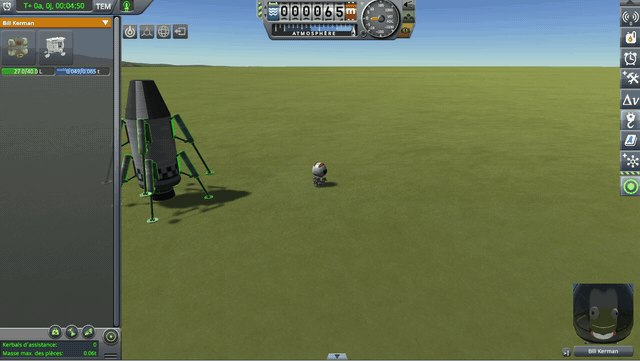
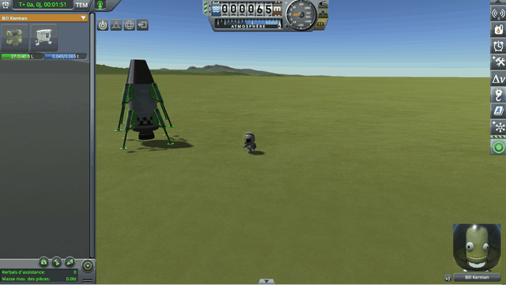

# A landing leg placed alone

Part of [Suspension Bounce Fix](../../README.md), [Damper Bounce](../README.md#checking-the-culprit):
[a damper too strong for what it moves in a step](../a-damper-too-strong-for-what-it-moves.md), here a part set for
another vessel.

A landing leg put down alone in EVA construction is thrown as soon as it has its own mass. In stock,
`ModuleCargoPart.MakePartSettle` makes a part placed alone weigh 4 t for its first 3 s on the ground, 20 t below
0.8 g. [Terrain Precision Fix](https://github.com/lhervier/KSP-Fix-TerrainPrecision), which this mod requires, gives
the part its own mass from the start, with its `fixLonePartMass` setting on: its foot is on the ground, and the damper
throws it. [Physics Easing Fix](https://github.com/lhervier/KSP-Fix-PhysicsEasing), which this mod also requires,
holds the leg still for a few physics steps once it is placed, as it does any vessel on wheels or legs that leaves the
rails on the ground, then lets it go with its full weight: the damper throws it about one time in two. Without this
mod, the damper is the game's
([a damper too strong for a light vessel](../../fixed-tuning/a-damper-too-strong-for-a-light-vessel.md)); with the
player's setting, the leg keeps the one it had on the lander.

## The save

[saves/SuspensionBounceLegKerbin.sfs](../saves/SuspensionBounceLegKerbin.sfs): Bill Kerman, an engineer, on EVA next
to `SuspensionBounce Lander`, a Mk1 pod on a fuel tank and an engine, standing on LT-1 landing legs, on Kerbin. Copy it
into the folder of a sandbox game, under `saves`, and load it from the quickload menu (Alt+F9 by default). With this
mod, the lander's suspensions were never set: the mod sets them as the save loads, from the lander's mass shared
equally among its legs ([Suspensions never set](../../fixed-tuning/README.md#suspensions-never-set)).

## By hand

1. Open the EVA construction panel and pick the *Place* tool.
2. Click one of the lander's legs that does not touch the ground: it is now held.
3. Click on the ground, foot down.

<table>
<tr>
<td width="50%"></td>
<td width="50%"></td>
</tr>
<tr>
<td valign="top"><em>KSP 1.12.5, KSP Community Fixes and Terrain Precision Fix: the leg, set down as above, from the
same lander on Kerbin in the save
<a href="https://github.com/lhervier/KSP-Fix-TerrainPrecision/blob/main/docs/lone-parts/diag/limits/landing-leg/landing-leg-kerbin.sfs.zip"><code>landing-leg-kerbin.sfs.zip</code></a>
of Terrain Precision Fix.</em></td>
<td valign="top"><em>KSP 1.12.5, KSP Community Fixes, Terrain Precision Fix and this mod, the game setting the
springs: the same leg, set down the same way from the same save.</em></td>
</tr>
</table>

Without this mod, the leg often leaves the ground as it is let go, spinning, rises a few metres and may be
destroyed when it lands (`landingLeg1 (…) Exploded!!` in `KSP.log`). With this mod, the leg tips over onto its side,
as a leg standing on its foot would, and may roll or stand up again before it comes to rest. With `logLevel = Debug`
in the settings, an earlier build of this mod, the game setting the springs, wrote:

```
[KSPFixSuspensionBounce] [DEBUG] Damper of landingLeg1 (3552957469) of Jambes d'atterrissage LT-1 limited to 0.924 for 0.037 t carried and 0.05 t moved, KSP computed 6
```

## By script

[diag/automation/check.py](../../diag/automation/check.py) plays these steps through
[KSP-Util-MCPServer](https://github.com/lhervier/KSP-Util-MCPServer): it clicks the leg, then a point of the ground
given in pixels of a KSP window of 1286 × 795; with a window of another size, give the point in front of Bill with
`--ground`. The leg is not the active vessel: the script takes a screenshot every 4 s and counts the `Exploded`
lines of `KSP.log`.

    python check.py leg-kerbin --folder <your sandbox game> --ksp <your KSP folder> --trials 3 --label stock

Played ten times in each configuration, KSP 1.12.5, KSP Community Fixes, Terrain Precision Fix
(`fixLonePartMass = true`), [KSP-Fix-AutoStrut](https://github.com/lhervier/KSP-Fix-AutoStrut) and Physics Easing
Fix, without [Parking Brake](https://github.com/jarosm/KSP-ParkingBrake), which this mod is not compatible with:
without this mod; with it and its default settings; and with Fixed Tuning alone, `damperBounce = false` and
`endStopSlide = false` in the mod's `settings.cfg`.

| | Without this mod | Fixed Tuning alone | This mod |
|---|---|---|---|
| Kerbin, 20 s after it is placed | out of sight or still in the air, 5 times out of 10 | out of sight, 6 times out of 10 | on its side next to where it was placed, 10 times out of 10 |
| `landingLeg1 (…) Exploded!!` in `KSP.log` | 3 times | once | never |

With Fixed Tuning alone, the leg keeps the setting it had on the lander, sized for its share of a lander of 3.9 t on
eight legs; this fix bounds its damper for the leg alone.
