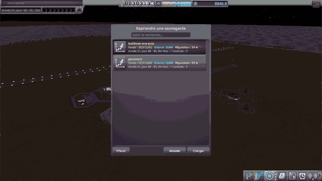
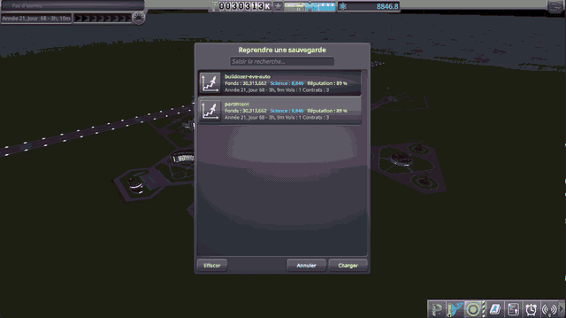

# A heavy rover on Eve

Part of [Suspension Bounce Fix](../../README.md), [checked](../../README.md#checked): the first culprit, a damper
too strong for a light vessel, here a heavy rover whose wheels hang from light trusses.

## The saves

Two saves of the same rover, six TR-2L wheels each at the end of a truss, at rest on Eve, its wheels left to the
game. Copy them into the folder of a sandbox game, under `saves`.

- [diag/SuspensionBounceHeavyRoverEve.sfs](../../diag/SuspensionBounceHeavyRoverEve.sfs): `SuspensionBounce Heavy
  Rover`, about 10 t, stock parts only.
- [diag/SuspensionBounceBulldozerEve.sfs](../../diag/SuspensionBounceBulldozerEve.sfs): `SuspensionBounce
  Bulldozer`, the same rover with a blade of 3.5 t in front, 14 t in all. The blade is a part of
  [KSP-Mod-Bulldozer](https://github.com/lhervier/KSP-Mod-Bulldozer), which must be installed.

## By hand

Load a save from the quickload menu (Alt+F9 by default), and watch the rover.

<table>
<tr>
<td width="50%"></td>
<td width="50%"></td>
</tr>
<tr>
<td valign="top"><em>KSP 1.12.5, KSP Community Fixes and KSP-Mod-Bulldozer: the bulldozer.</em></td>
<td valign="top"><em>KSP 1.12.5, KSP Community Fixes, KSP-Mod-Bulldozer and this mod: the bulldozer.</em></td>
</tr>
</table>

Without this mod, the rover hops on its wheels as soon as physics starts, and its wheels break as they come down.
With this mod, it stays on its wheels.

## By script

[diag/automation/check.py](../../diag/automation/check.py) loads a save through
[KSP-Util-MCPServer](https://github.com/lhervier/KSP-Util-MCPServer) and records
[KSP Diag - Suspension](https://github.com/lhervier/KSP-Diag-Suspension) for 30 s; its first lines say how to run it:

    python check.py heavy-rover-eve --folder <your sandbox game> --ksp <your KSP folder> --label stock
    python check.py bulldozer-eve --folder <your sandbox game> --ksp <your KSP folder> --trials 3 --label stock

Played without this mod and with it, KSP 1.12.5 and KSP Community Fixes (and KSP-Mod-Bulldozer for the bulldozer):

| | Without this mod | With this mod |
|---|---|---|
| Rover of 10 t, once: top speed over the ground | 2.9 m/s | 0.05 m/s |
| Time with no wheel on the ground | 11 % | 0 |
| Speed over the last 10 s | up to 0.85 m/s | up to 1.5 mm/s |
| `KSP.log` | `Hit Eve … at 73.5 m.s and damaged wheel.` | nothing |
| Bulldozer, 3 times: top speed over the ground | 2.2 to 3.4 m/s | 0.07 m/s |
| Time with no wheel on the ground | 4 to 20 % | 0 |
| `KSP.log` | `Hit Eve … at 58.0 to 125.3 m.s and damaged wheel`, at every trial | nothing |
