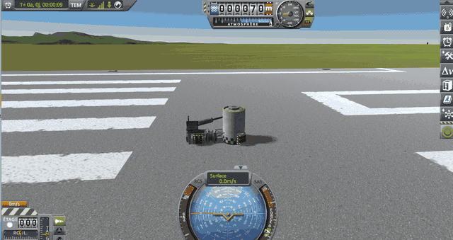

# A landing leg swung against a fuel tank

Part of [Suspension Bounce Fix](../../README.md), [checked](../../README.md#checked): the first culprit, a damper
too strong for a light vessel, met on the side of another vessel.

A part placed alone that rolls against a lander can be pushed off, but only by chance. This setup makes it every
time. It needs the rotation servos of Breaking Ground.

## The save

[diag/SuspensionBounceCulprit3.sfs](../../diag/SuspensionBounceCulprit3.sfs) holds two vessels on the runway, docked
together by a pair of Clamp-O-Tron Jr. docking ports:

- `SuspensionBounceCulprit3`: an FL-T400 tank standing upright, with a probe core;
- `SuspensionBounceCulprit3 Probe`, about 400 kg: a probe core, batteries and an F-12 rotation servo, with an LT-2
  landing leg fixed on the servo, lying horizontal, its foot a little away from the FL-T400.

Copy it into the folder of a sandbox game, under `saves`.

## By hand

1. In that game, at the space centre, open the quickload menu (Alt+F9 by default) and load
   `SuspensionBounceCulprit3`.
2. Right-click one of the two docking ports and undock, then switch to `SuspensionBounceCulprit3 Probe` (`]`).
3. Right-click the F-12 servo and set its target angle to 179 (not 180: the slider makes it -179.99, and the
   servo turns the other way): the servo swings the leg until its foot meets the side of the FL-T400, almost
   parallel to it.

*KSP 1.12.5, KSP Community Fixes and this mod: the same save as the last image at the top of the README.*

Without this mod, the light vessel is thrown sideways the moment the foot touches, much harder than the swing of the
leg can explain; not at every try, but a few tries are enough, and it can be thrown hard enough to break apart. With
this mod, it is pushed aside at a walking pace and comes to rest, undamaged.

It is not perfect: the suspension still takes the side of the tank for ground, and compresses against it where a real
leg would just knock against the tank. Its ray, nearly parallel to the curved side, can meet it already deep inside
from one step to the next: the suspension reads a very fast compression that the leg does not make, and its damper
pushes back against it. The vessel still gets a short kick whenever the foot meets the tank again, but the kick stays
small. The ground, broad and smooth, does not do this.

## By script

[diag/automation/run-tank-graze.py](../../diag/automation/run-tank-graze.py) plays these steps several times in a
row, through [KSP-Util-MCPServer](https://github.com/lhervier/KSP-Util-MCPServer); its first lines say how to run it.

    python run-tank-graze.py --folder <your sandbox game> --trials 10 --out out

Played ten times in a row by the script: without this mod, the light vessel broke apart seven times; with it, never.
