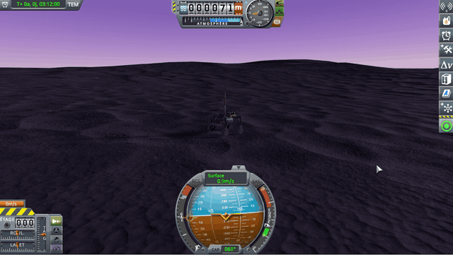
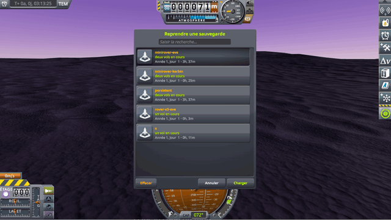

# A light rover on Eve

Part of [Suspension Bounce Fix](../../README.md), [checked](../../README.md#checked): the first culprit, a damper
too strong for a light vessel, made worse by a heavy world.

## The save

[diag/SuspensionBounceLightRoverEve.sfs](../../diag/SuspensionBounceLightRoverEve.sfs): `SuspensionBounce Light
Rover`, a rover of a quarter of a ton on four RoveMax S2 wheels, at rest on Eve. It stands still on Kerbin; it was
set down on Eve, saved there, and the save is what you load. Copy it into the folder of a sandbox game, under
`saves`.

## By hand

Load the save from the quickload menu (Alt+F9 by default), and watch the rover.

<table>
<tr>
<td width="50%"></td>
<td width="50%"></td>
</tr>
<tr>
<td valign="top"><em>KSP 1.12.5 and KSP Community Fixes.</em></td>
<td valign="top"><em>KSP 1.12.5, KSP Community Fixes and this mod.</em></td>
</tr>
</table>

Without this mod, the rover bounces on its wheels as soon as physics starts, higher and higher, and does not come to
rest. With this mod, it stays on its wheels.

## By script

[diag/automation/check.py](../../diag/automation/check.py) loads the save through
[KSP-Util-MCPServer](https://github.com/lhervier/KSP-Util-MCPServer) and records
[KSP Diag - Suspension](https://github.com/lhervier/KSP-Diag-Suspension) for 30 s; its first lines say how to run it:

    python check.py light-rover-eve --folder <your sandbox game> --ksp <your KSP folder> --label stock

Played once without this mod and once with it, KSP 1.12.5 and KSP Community Fixes:

| | Without this mod | With this mod |
|---|---|---|
| Top speed over the ground | 24 m/s | 0.04 m/s |
| Time with no wheel on the ground | 47 % | 0 |
| Speed over the last 10 s | up to 0.40 m/s | up to 0.2 mm/s |
| `KSP.log` | `roverWheel2 Exploded!!` | nothing |
