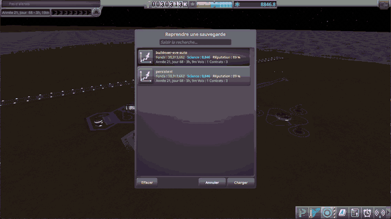
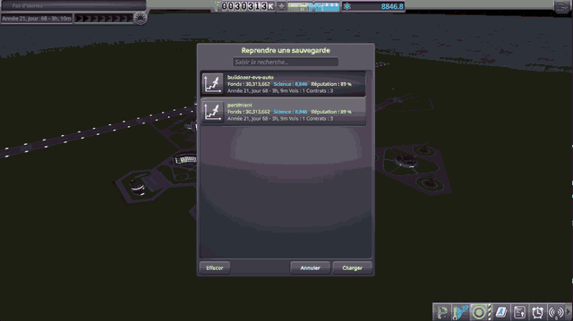

# A heavy rover on Eve

Part of [Suspension Bounce Fix](../../../README.md), [Damper Bounce](../README.md#checking-the-culprit):
[a damper too strong for what it moves in a step](../a-damper-too-strong-for-what-it-moves.md), here a heavy
rover whose wheels hang from light trusses.

## The saves

Two saves of the same rover, at rest on Eve: a Mk2 lander can, three ore tanks, six TR-2L wheels each at the end of a
truss, 26 parts. Its suspensions were never set: without this mod, the game sets them; with it, the mod sets them as
the save loads, from the rover's mass shared equally among its wheels
([Suspensions never set](../../fixed-tuning/README.md#suspensions-never-set)). Copy the saves into the folder of a
sandbox game, under `saves`.

- [saves/SuspensionBounceHeavyRoverEve.sfs](../saves/SuspensionBounceHeavyRoverEve.sfs): `SuspensionBounce Heavy
  Rover`, 14.05 t, stock parts only: 4.9 t of parts, and 9 t of ore in three Small Holding Tanks.
- [saves/SuspensionBounceBulldozerEve.sfs](../saves/SuspensionBounceBulldozerEve.sfs): `SuspensionBounce
  Bulldozer`, the same rover with a blade of 3.5 t in front in place of one of its ore tanks, 13.96 t in all. The
  blade is a part of [KSP-Mod-Bulldozer](https://github.com/lhervier/KSP-Mod-Bulldozer), which must be installed.

## By hand

Load a save from the quickload menu (Alt+F9 by default), and watch the rover.

<table>
<tr>
<td width="50%"></td>
<td width="50%"></td>
</tr>
<tr>
<td valign="top"><em>KSP 1.12.5, KSP Community Fixes and KSP-Mod-Bulldozer: the bulldozer.</em></td>
<td valign="top"><em>KSP 1.12.5, KSP Community Fixes, KSP-Mod-Bulldozer and this mod: the bulldozer.</em></td>
</tr>
</table>

Without this mod, the rover hops on its wheels as soon as physics starts, and its wheels break as they come down.
With this mod, it stays on its wheels.

## By script

[diag/automation/check.py](../../diag/automation/check.py) loads a save through
[KSP-Util-MCPServer](https://github.com/lhervier/KSP-Util-MCPServer) and records
[KSP Diag - Suspension](https://github.com/lhervier/KSP-Diag-Suspension) for 30 s; its first lines say how to run it:

    python check.py heavy-rover-eve --folder <your sandbox game> --ksp <your KSP folder> --label stock
    python check.py bulldozer-eve --folder <your sandbox game> --ksp <your KSP folder> --trials 3 --label stock

Played three times in each configuration, KSP 1.12.5, KSP Community Fixes,
[Terrain Precision Fix](https://github.com/lhervier/KSP-Fix-TerrainPrecision),
[KSP-Fix-AutoStrut](https://github.com/lhervier/KSP-Fix-AutoStrut) and
[Physics Easing Fix](https://github.com/lhervier/KSP-Fix-PhysicsEasing), without
[Parking Brake](https://github.com/jarosm/KSP-ParkingBrake), which this mod is not compatible with, and, for the
bulldozer, KSP-Mod-Bulldozer: without this mod; with it and its default settings; and with Fixed Tuning alone,
`damperBounce = false` and `endStopSlide = false` in the mod's `settings.cfg`. Physics Easing Fix holds the rover still
as it loads, and lets it go once its wheels hold it.

| | Without this mod | Fixed Tuning alone | This mod |
|---|---|---|---|
| **Heavy rover**: top speed over the ground | 2.6 to 4.5 m/s | 1.7 to 2.8 m/s | 0.01 m/s |
| Time with no wheel on the ground | 14 to 17 % | 3 to 9 % | 0 |
| How far it turned in 30 s | −508°, 1192°, −403° | 975°, −107°, 364° | 0.15° to 0.22° |
| Speed over the last 10 s | up to 5.6 mm/s, 1.7 m/s and 11 mm/s | up to 2.8 m/s, 0.57 mm/s and 0.67 mm/s | up to 1.7 mm/s |
| `KSP.log` | `Hit Eve … at 30.4 to 173.8 m.s and damaged wheel.`, 3 trials out of 3 | `Hit Eve … at 94.6 to 110.0 m.s and damaged wheel.`, 3 trials out of 3 | nothing |
| **Bulldozer**: top speed over the ground | 2.9 to 6.8 m/s | 0.88 to 2.0 m/s | 0.07 m/s |
| Time with no wheel on the ground | 79 to 94 % | 2 to 12 % | 0 |
| How far it turned in 30 s | 202°, −200°, −121° | 203°, −16°, −41° | −0.7° to 0.3° |
| Speed over the last 10 s | up to 0.15, 59 and 9.2 mm/s | up to 0.41, 2.0 and 1.8 m/s | up to 0.5 mm/s |
| `KSP.log` | `Hit Eve … at 25.1 to 168.5 m.s and damaged wheel.`, 3 trials out of 3 | `Hit Eve … at 101.3 to 104.8 m.s and damaged wheel.`, 1 trial out of 3 | nothing |

Without this mod, both are let go at rest on their wheels, and hop all the same.
