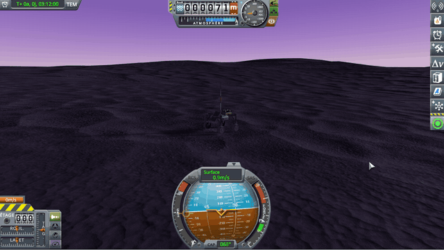
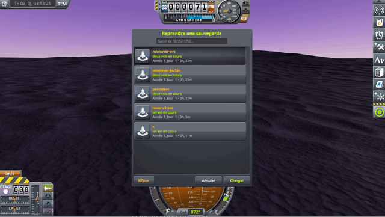

# A light rover on Eve

Part of [Suspension Bounce Fix](../../../README.md), [Fixed Tuning](../README.md#checking-the-culprit):
[a damper too strong for a light vessel](../a-damper-too-strong-for-a-light-vessel.md), made worse by
a heavy world.

## The save

[saves/SuspensionBounceLightRoverEve.sfs](../saves/SuspensionBounceLightRoverEve.sfs): `SuspensionBounce Light
Rover`, a rover of a quarter of a ton on four RoveMax S2 wheels, at rest on Eve. It stands still on Kerbin; it was
set down on Eve, saved there, and the save is what you load. Its suspensions were never set: without this mod, the
game sets them; with it, the mod sets them as the save loads, from the rover's mass shared equally among its wheels
([Suspensions never set](../README.md#suspensions-never-set)). Copy it into the folder of a sandbox game, under
`saves`.

## By hand

Load the save from the quickload menu (Alt+F9 by default), and watch the rover.

<table>
<tr>
<td width="50%"></td>
<td width="50%"></td>
</tr>
<tr>
<td valign="top"><em>KSP 1.12.5 and KSP Community Fixes.</em></td>
<td valign="top"><em>KSP 1.12.5, KSP Community Fixes and this mod.</em></td>
</tr>
</table>

Without this mod, the rover bounces on its wheels as soon as physics starts, and does not come to rest. With this mod,
it stays on its wheels.

## By script

[diag/automation/check.py](../../diag/automation/check.py) loads the save through
[KSP-Util-MCPServer](https://github.com/lhervier/KSP-Util-MCPServer) and records
[KSP Diag - Suspension](https://github.com/lhervier/KSP-Diag-Suspension) for 30 s; its first lines say how to run it:

    python check.py light-rover-eve --folder <your sandbox game> --ksp <your KSP folder> --label stock

Played three times in each configuration, KSP 1.12.5, KSP Community Fixes,
[Terrain Precision Fix](https://github.com/lhervier/KSP-Fix-TerrainPrecision),
[KSP-Fix-AutoStrut](https://github.com/lhervier/KSP-Fix-AutoStrut) and
[Physics Easing Fix](https://github.com/lhervier/KSP-Fix-PhysicsEasing), without
[Parking Brake](https://github.com/jarosm/KSP-ParkingBrake), which this mod is not compatible with: without this mod;
with it and its default settings; and with Fixed Tuning alone, `damperBounce = false` and `endStopSlide = false` in
the mod's `settings.cfg`. Physics Easing Fix holds the rover still as it loads, and lets it go once its wheels hold it.

| | Without this mod | Fixed Tuning alone | This mod |
|---|---|---|---|
| Top speed over the ground | 2.0 to 3.3 m/s | 0.05 m/s | 0.05 m/s |
| Time with no wheel on the ground | 32 to 65 % | 0 | 0 |
| Speed over the last 10 s | 1.0, 1.8 and 3.3 m/s | up to 0.12 mm/s | up to 0.16 mm/s |
| `KSP.log` | nothing | nothing | nothing |

Without this mod, the rover is let go at rest on its wheels, and the game's damper sets it bouncing all the same: it
never comes to rest. Fixed Tuning alone keeps the rover on its wheels: the mod's other fixes change nothing here.
