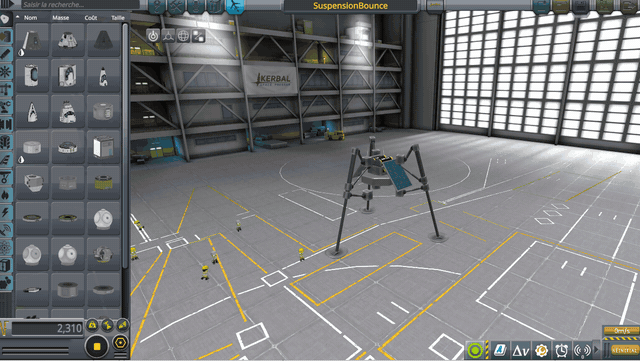
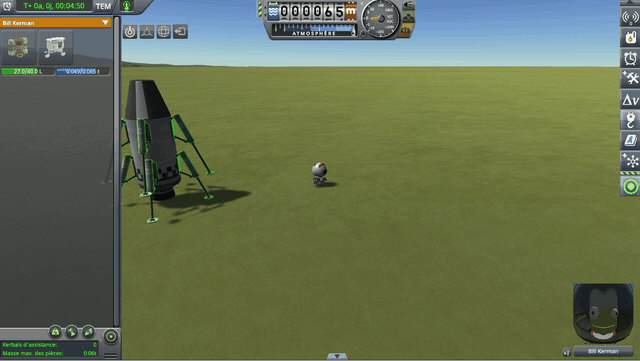
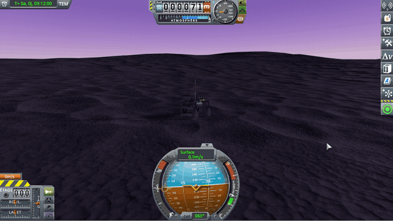
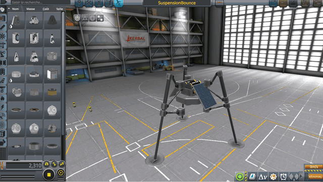
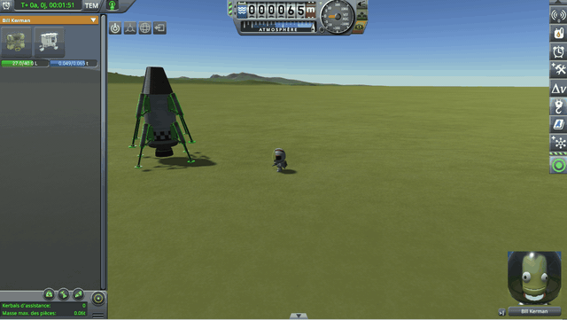
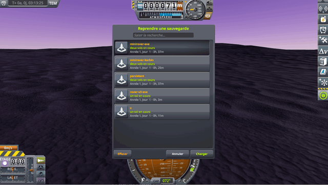

# First culprit: a damper too strong for a light vessel

Part of [Suspension Bounce Fix](../../README.md), [the culprits](../../README.md#the-culprits): a culprit that throws.

Because of the [floor](the-patches.md#the-half-ton-floor), a leg carrying 50 kg gets the stiffness of a leg carrying
half a ton, and the damper that goes with it. For this leg, the damper is far too strong, and it throws it (see
[why a damper can throw a vessel](../../README.md#why-a-damper-can-throw-a-vessel)). A probe of 100 kg on
three legs is thrown by it as soon as physics starts. So is a landing leg placed alone in EVA construction, when
[Terrain Precision Fix](https://github.com/lhervier/KSP-Fix-TerrainPrecision) gives it its own mass from the start; in
stock, it is [the second culprit](a-suspension-in-the-air-keeps-its-settings.md) that throws it.

<table>
<tr>
<td width="50%"></td>
<td width="50%"></td>
</tr>
<tr>
<td valign="top"><em>KSP 1.12.5 and KSP Community Fixes, without this mod: the probe of
<a href="../../README.md#a-light-probe-on-the-runway">A light probe on the runway</a>, launched from the SPH onto the
runway.</em></td>
<td valign="top"><b>Not in stock: without Terrain Precision Fix, the same leg lies down on Kerbin and stays there.</b><br>
<em>KSP 1.12.5, KSP Community Fixes and Terrain Precision Fix, without this mod: on Kerbin, the save
<a href="https://github.com/lhervier/KSP-Fix-TerrainPrecision/blob/main/diag/lone-parts/limits/landing-leg/landing-leg-kerbin.sfs"><code>landing-leg-kerbin.sfs</code></a>
of Terrain Precision Fix; in EVA construction, Bill Kerman takes a leg off the lander and sets it down on its
foot.</em></td>
</tr>
</table>

A heavy world makes this culprit worse. On Kerbin, a vessel of a few hundred kilograms stays just under the limit: its
damper, the one of the floor's half ton, takes off almost all the leg's speed at each step, without sending it back.
On Eve, the same damper, two to three times as strong
([slider set automatically](the-patches.md#the-automatic-sliders) and [high gravity](the-patches.md#high-gravity)),
goes past the limit: a small rover that stands still on the runway of Kerbin bounces higher and higher on Eve, and
never settles. It can hold for a while, its wheels almost still; at the first disturbance, a bump, a wheel touching the
ground again, each step amplifies the motion once more.



*KSP 1.12.5 and KSP Community Fixes, without this mod: a rover of a quarter of a ton on four RoveMax S2 wheels, set
down on Eve, saved, and loaded there.*

## What the mod changes

It keeps KSP's spring, the floor included: a vessel sinks on its legs as it would without the mod, and removing the
floor would bring back the spring stuck at zero that it prevents. It also keeps KSP's damper, unless it is too strong
for the mass the leg has to slow down. That mass is the share of the weight the leg carries, or less for a wheel far
from the vessel's centre: pushed there, the vessel turns as much as it rises, and the wheel only sets part of it in
motion. The mod then brings the damper down to a limit: the damper that takes off at most half the leg's speed in a
step, well short of sending it back. No more than half: a damper that stopped the leg in one step would already be on
the edge, and the wheels of a rover, at the end of trusses whose joints give way, first set even less mass in motion.

An ordinary vessel stays far below that limit, and behaves exactly as without the mod; only very light vessels, and
light rovers on a heavy world, reach it.

<table>
<tr>
<td width="50%"></td>
<td width="50%"></td>
</tr>
<tr>
<td valign="top"><em>KSP 1.12.5, KSP Community Fixes and this mod: the probe of
<a href="../../README.md#a-light-probe-on-the-runway">A light probe on the runway</a>, launched from the SPH onto the
runway.</em></td>
<td valign="top"><em>KSP 1.12.5, KSP Community Fixes, Terrain Precision Fix and this mod: the same leg, set down the
same way on Kerbin from the save
<a href="https://github.com/lhervier/KSP-Fix-TerrainPrecision/blob/main/diag/lone-parts/limits/landing-leg/landing-leg-kerbin.sfs"><code>landing-leg-kerbin.sfs</code></a>.</em></td>
</tr>
</table>



*KSP 1.12.5, KSP Community Fixes and this mod: the same rover, loaded on Eve from the same save.*

## In the mod's code

A postfix of `ModuleWheelSuspension.SuspensionSpringUpdate`, which KSP calls at every step where the wheel touches
something, in [Src/SuspensionDamper.cs](../../Src/SuspensionDamper.cs) (`SuspensionSpringUpdatePostfix`). The leg's
share is the vessel's mass shared between the wheels on the ground, counted once per vessel and per step (`Count`);
`Apply` starts from the damper KSP has just worked out:

```csharp
float share = (float)vessel.totalMass / Mathf.Max(count.Grounded, 1);
Apply(__instance, wheel, share, StockDamper(__instance), false);
```

In `Apply`, the share is capped by the mass the vessel sets in motion at the point of contact, worked out by
`VesselInertia.EffectiveMass` in [Src/VesselInertia.cs](../../Src/VesselInertia.cs). `VesselInertia` adds up, once per
vessel and per step, the mass, the centre of mass and the inertia tensor of the parts' rigidbodies (each part's own
inertia, turned to world axes, plus its mass about the centre of mass). At the point of contact
(`wheelState[0].hit.point`), along the normal of the surface (`wheelState[0].hit.normal`), or at the wheel along the
local vertical when it touches nothing, the vessel answers as a mass m, with
1 / m = 1 / M + (r × n) · I⁻¹ · (r × n), r the point from the centre of mass, n the normal:

```csharp
share = Mathf.Min(share, (float)inertia.EffectiveMass(point, normal));
```

Then the damper is brought down to the limit if it is above it:

```csharp
float limit = share / (2f * Time.fixedDeltaTime);
bool isLimited = damper > limit;
```

The mod only writes on the wheel what it changes, and once more at the step where it stops changing it: KSP itself only
writes a damper that differs from the wheel's by more than 1.05
([rounding and the write threshold](the-patches.md#rounding-and-the-write-threshold)), and would otherwise keep the
mod's:

```csharp
if (isLimited || wasLimited)
{
    wheel.wheelCollider.damperRate = damper;
}
```
