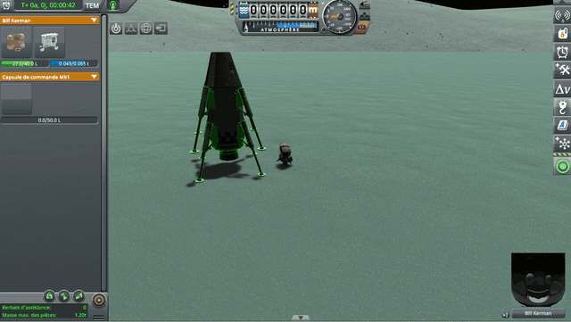
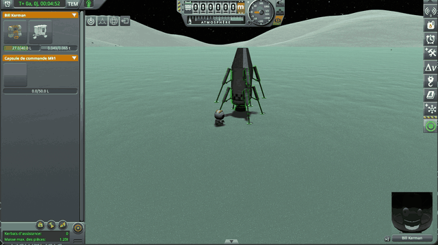

# Second culprit: a suspension in the air keeps its old settings

Part of [Suspension Bounce Fix](../../README.md), [the culprits](../../README.md#the-culprits): a culprit that throws.

In the air, the wheel keeps the spring and the damper of its last contact (see [the base model](the-base-model.md)).
At the next contact, it first pushes with those old settings, then KSP works them out again. No harm if the vessel has
kept its mass in the meantime.

Not so for a part placed alone in EVA construction: for its first three seconds on the ground, KSP makes it weigh 4 t,
and even 20 t under low gravity. A leg that leaves the ground during that time keeps a suspension set for 20 t. When
its foot touches the ground again, back to its own 50 kg, that suspension throws it.



*KSP 1.12.5 and KSP Community Fixes, without this mod or Terrain Precision Fix: on Minmus, the save
[`landing-leg-minmus.sfs`](https://github.com/lhervier/KSP-Fix-TerrainPrecision/blob/main/diag/lone-parts/limits/landing-leg/landing-leg-minmus.sfs)
of Terrain Precision Fix; in EVA construction, Bill Kerman takes a leg off the lander and sets it down on its foot
(see [A landing leg placed alone](../../README.md#a-landing-leg-placed-alone)). Overlaid at the bottom right, the mass
of the leg, added in editing: 20 t and the time left, from the click that sets it down, counted on the game's clock
(`ModuleCargoPart.MakePartSettle`), then its own 50 kg.*

With [Terrain Precision Fix](https://github.com/lhervier/KSP-Fix-TerrainPrecision), the leg never weighs 20 t: it has
its 50 kg as soon as it is set down, and this culprit is gone. The symptom, though, comes at once: the leg, still
standing on its foot, gets the too strong damper of the [first culprit](a-damper-too-strong-for-a-light-vessel.md),
and is thrown as soon as it touches the ground.

## What the mod changes

In the air too, it brings the damper down under
[the limit](a-damper-too-strong-for-a-light-vessel.md#what-the-mod-changes), for the smallest share the leg will carry:
the one it will have when all the vessel's wheels touch. At the next contact, the damper already suits the leg. The
spring keeps its last setting.

The `airDamper` setting of the `settings.cfg` file turns this part of the mod off, independently of the
[first culprit](a-damper-too-strong-for-a-light-vessel.md)'s `damperLimit`.



*KSP 1.12.5, KSP Community Fixes and this mod, without Terrain Precision Fix: the same leg, set down the same way on
Minmus from the same save. Overlaid at the bottom right, the mass of the leg, added in editing as above: 20 t and the
time left, then its own 50 kg.*

## In the mod's code

A postfix of `ModuleWheelSuspension.FixedUpdate`, which KSP calls at every step, in
[Src/SuspensionDamper.cs](../../Src/SuspensionDamper.cs) (`FixedUpdatePostfix`). It leaves a wheel that touches
something to the postfix of the [first culprit](a-damper-too-strong-for-a-light-vessel.md#in-the-mods-code), and a part
on rails (`packed`) to KSP:

```csharp
if (!HighLogic.LoadedSceneIsFlight || wheel == null || wheel.wheelCollider == null || vessel == null ||
    __instance.part == null || __instance.part.packed || wheel.IsGrounded)
{
    return;
}
```

In the air, the share is the vessel's mass shared between all its suspensions, and `Apply` caps the damper KSP worked
out last, not the wheel's, which may already be the mod's:

```csharp
float share = (float)vessel.totalMass / Mathf.Max(count.All, 1);
Apply(__instance, wheel, share, StockDamper(__instance), true);
```

`Apply` is the one of the first culprit: it caps the share by the mass the vessel sets in motion at the wheel, from the
same read of the vessel's rigidbodies, made once per vessel and per step
([In the mod's code](a-damper-too-strong-for-a-light-vessel.md#in-the-mods-code)).

In `Apply`, a limited suspension stays marked as such as long as its wheel is in the air: at the next contact, if
KSP's damper no longer needs capping, the mod writes it on the wheel in place of its own.

```csharp
else if (offGround)
{
    // Off the ground, the damper on the wheel is not the game's: one lowered earlier stays marked, so that
    // the game's own damper is set back at the next contact.
    wasLimited = false;
}
```
