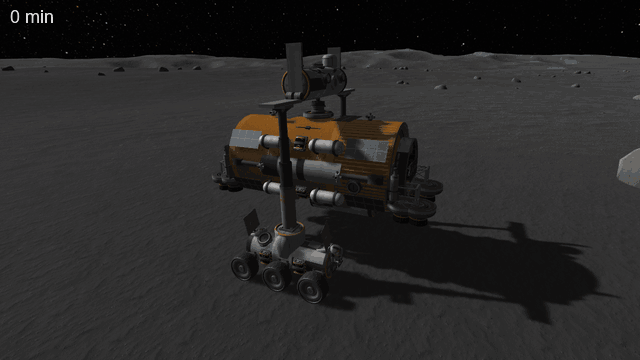

# Cinquième coupable : le pneu combat un glissement qui n'existe pas

Fait partie de [Suspension Bounce Fix](../../README.md), [les coupables](../../README.md#the-culprits) : un coupable qui
fait glisser les vaisseaux.

Pour savoir si un pneu glisse, VPP lit la vitesse du corps de la roue. Sur un vaisseau fait de plusieurs pièces, cette
vitesse ment : elle contient une vitesse qui ne déplace rien.

## Ce que VPP lit pour savoir si le pneu glisse

À chaque pas, VPP calcule la vitesse du point de contact du pneu sur le sol, à partir de la vitesse du corps rigide de
la roue, celle que rend la physique d'Unity. Tout le travail du pneu en dépend : sous 1 m/s environ, la force qui le
retient est proportionnelle à cette vitesse ([sixième coupable](a-tyre-has-no-static-grip.md)) ; au-delà, le frottement
suit le glissement. Une vitesse fausse, c'est un pneu qui pousse pour rien.

## Les vitesses fantômes

Un vaisseau de KSP est fait de pièces reliées par des joints. Sous une charge, un joint s'écarte un peu de sa position,
et la physique le corrige à chaque pas, en deux temps :

- **les itérations de position** résolvent les joints et les contacts avec un terme de correction, qui ramène les
  pièces là où leurs joints les veulent ; les pièces avancent avec cette vitesse, correction comprise ;
- **les itérations de vitesse** rejouent le même calcul sans le terme de correction ; c'est cette vitesse-là que la
  physique rend.

La correction déplace donc les pièces, mais n'apparaît pas dans leur vitesse. Sur un joint qui porte une charge
constante, comme le poids d'un vaisseau garé, la correction revient à chaque pas, toujours la même : la vitesse de la
pièce garde un écart constant avec son vrai mouvement. Deux pièces qui se poussent l'une l'autre ont des écarts
opposés : ils s'annulent sur le vaisseau entier, pas pièce par pièce.

Mesuré sur une grue de 33 t posée sur la Mune, freins serrés, à l'arrêt depuis longtemps : une roue avance réellement de
0,38 mm/s, sa vitesse annonce 1,71 mm/s ; une autre avance de 0,34 mm/s, sa vitesse annonce −2,60 mm/s. Les deux roues
avancent ensemble, et leurs vitesses annoncent deux glissements opposés, stables d'un pas à l'autre.

## Pourquoi KSP en souffre

VPP est écrit pour une voiture faite d'un seul corps rigide : sans joints, la vitesse du corps est son mouvement. KSP
fait autrement : chaque roue est un véhicule VPP à elle seule, sur sa propre pièce, reliée au reste par des joints qui
portent le poids du vaisseau. Chaque roue hérite de la vitesse fantôme de sa pièce, et son pneu la prend pour un
glissement.

## Ce qu'on voit

Garé freins serrés, un vaisseau lourd de nombreuses pièces dérive lentement, à vitesse constante, toujours dans la même
direction. Trop lentement pour qu'on le remarque d'un coup d'œil : la grue de la Mune glisse de 1,1 mm/s, mais au bout
de vingt minutes, elle s'est déplacée de plus d'un mètre.



*KSP 1.12.5, KSP Community Fixes, Terrain Precision Fix, KSP-Fix-AutoStrut et ce mod, dont on a seulement désactivé la
correction de ce coupable (`tyreReadsPoses = false`) : la grue de 33 t de la sauvegarde
[diag/SuspensionBounceCraneMun.sfs](../../diag/SuspensionBounceCraneMun.sfs), freins serrés, Parking Brake desserré.
Vingt minutes, accélérées près de 200 fois ; la caméra suit la grue, c'est le sol qui semble glisser, voyez le rocher à
droite. Elle dérive de 1,12 mm/s, sans jamais accélérer ni ralentir, de côté vers sa gauche : 1,32 m en 19 min 30 s,
en tournant de 3,3°. L'ombre bouge aussi un peu : le soleil monte pendant ces vingt minutes.*

Ce n'est pas un manque d'adhérence : les pneus en ont, mais ils l'usent à se battre entre eux. Sur la grue, chaque roue
pousse de côté avec environ 1,7 kN, dans un sens ou dans l'autre selon la roue, à 96 à 99 % de sa limite d'adhérence,
alors que la pente ne demande que 1,34 kN pour toutes les roues ensemble. Il ne reste plus au pneu de réserve pour tenir
la vraie pente.

## Le voir

[KSP Diag - Suspension](https://github.com/lhervier/KSP-Diag-Suspension) montre, roue par roue, la force du pneu et la
part de son adhérence qu'il utilise (colonne *Used*). Avec la sauvegarde
[diag/SuspensionBounceCraneMun.sfs](../../diag/SuspensionBounceCraneMun.sfs), sans ce mod :

1. Charger la sauvegarde, et desserrer Parking Brake.
2. Attendre une minute.

La grue est presque immobile, mais ses pneus sont tout près de 100 % de leur adhérence, et poussent les uns contre les
autres.

## Dans le code

Dans `VehiclePhysics.VehicleBase.CalculateLocalFrame`, la vitesse du contact vient de la roue :

```csharp
wheel.wheelVelocity = wheel.wheelCol.GetTangentVelocity(wheel.hit.point, wheel.hit.normal, wheel.hit.collider.attachedRigidbody);
wheel.localWheelVelocity.y = Vector3.Dot(wheel.hit.forwardDir, wheel.wheelVelocity);
wheel.localWheelVelocity.x = Vector3.Dot(wheel.hit.sidewaysDir, wheel.wheelVelocity);
```

et `VPWheelCollider.GetTangentVelocity` la lit dans la vitesse du corps rigide de la roue :

```csharp
Vector3 pointVelocity = m_rigidbody.GetPointVelocity(contactPoint);
if (surfaceRigidbody != null)
{
    pointVelocity -= surfaceRigidbody.GetPointVelocity(contactPoint);
}
return pointVelocity - Vector3.Project(pointVelocity, surfaceNormal);
```

La physique est celle de PhysX, que la source de PhysX 4.1, la version d'Unity 2019, rend publique. Chaque ligne d'un
joint a deux constantes : avec le terme de correction (`geomError`), et sans lui (`forInternalUse`, nul pour un joint)
([DyConstraintSetup.cpp](https://github.com/NVIDIAGameWorks/PhysX/blob/4.1/physx/source/lowleveldynamics/src/DyConstraintSetup.cpp)
et [DySolverConstraint1D.h](https://github.com/NVIDIAGameWorks/PhysX/blob/4.1/physx/source/lowleveldynamics/src/DySolverConstraint1D.h)) :

```cpp
rows[i].forInternalUse = rows[i].flags & Px1DConstraintFlag::eKEEPBIAS ? rows[i].geometricError : 0;
...
constant = recipResponse * (c.velocityTarget - geomError*recipdt);
unbiasedConstant = recipResponse * (c.velocityTarget - c.forInternalUse*recipdt);
```

La dernière itération de position remplace la constante de chaque ligne par celle sans correction ; la vitesse qui
déplacera les corps est alors mise de côté, et les itérations de vitesse reprennent sans la correction
([DySolverControl.cpp](https://github.com/NVIDIAGameWorks/PhysX/blob/4.1/physx/source/lowleveldynamics/src/DySolverControl.cpp)
et [DySolverConstraints.cpp](https://github.com/NVIDIAGameWorks/PhysX/blob/4.1/physx/source/lowleveldynamics/src/DySolverConstraints.cpp)) :

```cpp
c.constant = c.unbiasedConstant;
...
Cm::SpatialVector& motionVel = motionVelocityArray[baIdx];
motionVel.linear = atom.linearVelocity;
motionVel.angular = atom.angularState;
```

Les corps avancent avec `motionVel` ; la vitesse rendue est celle des itérations qui suivent, sans la correction.

## Ce que change le mod

Le pneu lit la vitesse de son contact dans le vrai mouvement de la roue : la position et l'orientation de son corps à
ce pas et au pas d'avant, divisées par la durée du pas. C'est la vitesse que la physique a vraiment intégrée, correction
comprise. Le mod ne réécrit rien dans la physique : seule change ce que VPP lit.

- La position est prise à l'origine du corps, pas à son centre de masse, que KSP replace quand il déballe un vaisseau :
  la vitesse du centre de masse s'en déduit par la rotation.
- Sans position au pas d'avant (premier pas, pas sauté, décalage de l'origine flottante, Krakensbane qui déplace le
  monde), le pneu lit la vitesse d'Unity, comme sans le mod.
- Une vitesse qui s'écarte de plus de 0,5 m/s de celle d'Unity est celle d'un vaisseau que le jeu a déplacé, pas la
  physique : le pneu lit alors la vitesse d'Unity pour ce pas.

Sur la grue, freins serrés, Parking Brake desserré, la somme des forces des pneus vaut 1,27 kN pour 1,34 kN de pente à
tenir : ils tiennent la pente, et rien d'autre. Ils sont à 8 à 16 % de leur adhérence. Une fois posée, après une
minute et demie, la grue dérive de 0,002 mm/s, au lieu de 1,1. Le rover lourd de la Mune, garé freins serrés, dérive
de 0,004 mm/s ; celui d'Eve, de 0,001 mm/s. En conduite, accélération, freinage et virages sont identiques à 1 % près.

Le réglage `tyreReadsPoses` du fichier `settings.cfg` coupe cette partie du mod.

## Dans le code du mod

Tout est dans [Src/PoseMotion.cs](../../Src/PoseMotion.cs).

Un préfixe de `VehicleBase.CalculateLocalFrame` prend la position du corps de chaque roue à chaque pas, au sol ou non,
pour qu'elle ait celle du pas d'avant quand elle touche le sol. La vitesse se déduit des deux positions
(`OriginVelocity`) :

```csharp
velocity = (pose.origin - pose.lastOrigin) / dt;
Quaternion turn = pose.rotation * Quaternion.Inverse(pose.lastRotation);
...
angularVelocity = new Vector3(turn.x, turn.y, turn.z) * (2f / dt);
```

Un préfixe de `VPWheelCollider.GetTangentVelocity` la donne à VPP, à la place de celle du corps rigide :

```csharp
if (!PointVelocity(WheelBody(__instance), contactPoint, out pointVelocity))
{
    return true;
}
if (surfaceRigidbody != null)
{
    pointVelocity -= surfaceRigidbody.GetPointVelocity(contactPoint);
}
__result = pointVelocity - Vector3.Project(pointVelocity, surfaceNormal);
return false;
```
