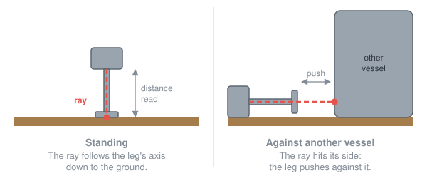

# The base model

Part of [Suspension Bounce Fix](../../README.md), [the culprits](../the-culprits.md): how KSP 1.12.5 sets the spring
and the damper of a suspension, before any patch.

In KSP, a suspension is a spring and a damper. The stiffness of the spring decides how far the leg sinks under the
vessel's weight. The damper slows the leg's movements, so that it does not bounce on and on. KSP runs them on its own,
by four simple rules.

**The suspension measures how far it has sunk along its axis**, like a stick held out in front: a ray leaves the wheel
along the leg's axis, and hits whatever it meets. How far it has sunk is the distance to that point. Consequences:

- **It works on any surface**: the ground, a runway, a building, the side of another vessel.
- **It pushes against what it touches**, even when that is not the ground: a leg lying against a lander pushes
  against it.



*The suspension's ray (in red) in two positions of the leg.*

**The spring follows the weight.** KSP shares the vessel's weight equally between the wheels that touch the ground,
and gives each one a spring to match its share. The more a leg carries, the stiffer its spring. Consequences:

- **The same sinking for all.** A light or a heavy vessel, on Kerbin or on the Mun, sinks about as far on its legs,
  and the player has nothing to set.
- **The loaded side sags.** All the legs get the same spring, the one of the average share, even when they do not
  carry as much: on a slope, the downhill legs carry more than their share and sink further, as on a real car, whose
  springs are all alike.
- **A very small weight gives a very small spring**, so small that KSP ends up rounding it down to zero: the leg is
  crushed against its stop. Hence [the floor](the-patches.md#the-half-ton-floor).
- **The share changes when a wheel touches or leaves the ground.** When a rover lands, the first wheel to touch gets
  for a moment the share of the whole vessel, then its share drops as the others touch: its spring changes from one
  step to the next.

**The damper follows the spring.** It is worked out from the spring alone, with a coefficient of each part's own: a
stiff spring gets a strong damper. Consequences:

- **Nothing else to know.** The damper sets itself each time the spring changes.
- **The mass only half goes into it.** It goes in through the spring, but not enough: to damp the same whatever the
  mass, the damper should grow as the mass, and it only grows as its square root. It suits a leg carrying about a
  ton. For a leg carrying several tons, it is softer, without harm: a vessel of 20 t on four legs settles in two
  oscillations, in two seconds on Kerbin, five on the Mun. For a leg carrying much less, it is too stiff
  ([first culprit](a-damper-too-strong-for-a-light-vessel.md)).

**The setting only happens on contact.** KSP only works out the spring and the damper again while the wheel touches
something; in the air, the wheel keeps those of its last contact. Consequences:

- **Nothing to work out in the air**, where the leg carries nothing and stays fully extended, whatever its spring.
- **At the next contact, the wheel first pushes with its old settings**, before KSP works them out again. No harm if
  the vessel has kept its mass in the meantime; otherwise, see
  [the second culprit](a-suspension-in-the-air-keeps-its-settings.md).

<details>
<summary>In the code</summary>

`SuspensionLoadBalancer.FixedUpdate` (a vessel module) gives each suspension the weight it carries,
`sprungMassGravity`: the vessel's mass times the surface gravity in g, rounded to the tenth, shared equally between the
wheels on the ground:

```csharp
num = Math.Round(num * vessel.gravityMultiplier * vessel.mainBody.GeeASL * 10.0) / 10.0;
...
share = Mathf.Round(100f / divisor) / 100f;
suspensionModules[j].sprungMassGravity = Mathf.Max((float)(num * (double)share * (double)multiplier), minMass);
```

`ModuleWheelSuspension.SuspensionSpringUpdate` turns that weight into a spring, then the spring into a damper
(`springRatio` and `damperRatio` are each part's own):

```csharp
spring = Mathf.Clamp(springTweakable * springRatio * sprungMassGravity * BoostCurve(boost, boostRatio + autoBoost), 0.01f, springClampMax);
damper = Mathf.Sqrt(Mathf.Clamp(spring * damperRatio * damperFudge, 0.01f, damperClampMax)) * damperTweakable;
```

`ModuleWheelSuspension.FixedUpdate` only calls it while the wheel touches something:

```csharp
if (HighLogic.LoadedSceneIsFlight && baseSetup && !base.part.packed && wheel != null && wheel.IsGrounded)
{
    vesselMass = (float)base.vessel.totalMass;
    SuspensionSpringUpdate(vesselMass);
}
```

</details>
