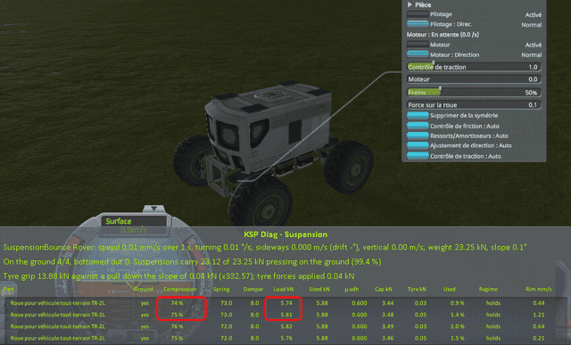
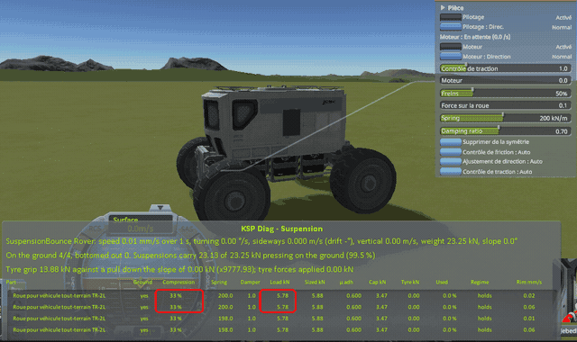
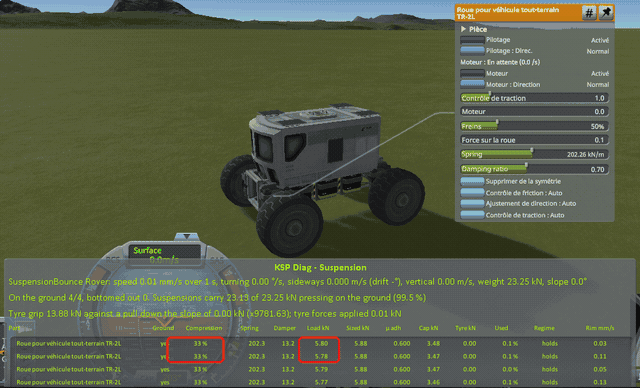

# A rover softened onto its end-stops

Part of [Suspension Bounce Fix](../../README.md), [End-Stop Slide](../README.md#checking-the-culprit):
[a bottomed wheel hides its weight from the tyres](../a-bottomed-wheel-hides-its-weight-from-the-tyres.md).

If this fix passed on the wrong weight, a rover on its end-stops would grip less or more than it should: slide as
without this mod, or hold where its tyres should slip. A rover at rest on flat ground has its springs softened step by
step, until its wheels rest on their end-stops, while
[KSP Diag - Suspension](https://github.com/lhervier/KSP-Diag-Suspension) shows the load each tyre reads and the share
of the vessel's weight its suspensions carry.

## The save

Copy it into the folder of a sandbox game, under `saves`, and load it from the quickload menu (Alt+F9 by default).

[saves/SuspensionBounceRoverFlat.sfs](../saves/SuspensionBounceRoverFlat.sfs): `SuspensionBounce Rover`, 2.4 t on four
TR-2L wheels, on flat ground near the space centre, brakes on, its suspensions never set: this mod sets them as the
save loads, from the rover's mass shared equally among its wheels
([Suspensions never set](../../fixed-tuning/README.md#suspensions-never-set)). Saved at rest, without Parking Brake.

## By hand

Load the save and open the window of KSP Diag - Suspension (Mod+F6). Open the *Suspensions* window of this mod (the
button with a spring on the toolbar), keep Kerbin as the body and the four wheels chosen, untick *Share by the vessel's
centre of mass*, keep *Compression* at 33 % and *Damping ratio* at 0.70, and tick *typed* next to *Mass*. Then, for
each mass of the table below, type it, press *Auto*, and wait a few seconds for the rover to settle; for the last
one, type 99 in *Compression* too. The lighter the mass typed, the softer the springs: from 0.3 t on, they are too soft
for the rover, and its wheels sink onto their end-stops (*Compression* 1.000 in the Diag's window).

Play it with this mod and its default settings, then with this fix alone turned off: `endStopSlide = false` in the
mod's `settings.cfg` (`GameData/KSPFixSuspensionBounce/PluginData`), KSP started again.

## What it shows

<table>
<tr>
<td width="50%"></td>
<td width="50%"></td>
</tr>
<tr>
<td valign="top"><em>KSP 1.12.5, KSP Community Fixes,
<a href="https://github.com/lhervier/KSP-Fix-TerrainPrecision">Terrain Precision Fix</a>,
<a href="https://github.com/lhervier/KSP-Fix-AutoStrut">KSP-Fix-AutoStrut</a> and
<a href="https://github.com/lhervier/KSP-Fix-PhysicsEasing">Physics Easing Fix</a>, without this mod: the save above,
the springs of the front wheels softened by hand in their window (Spring/Damper: Override, Spring Strength lowered
from 1 to 0.05). Framed in red, for the front wheels, their compression and the load their tyres read
(<em>Load kN</em>): the load holds while the softer spring only sinks the wheel, drops once the compression reaches
100 % (<em>stop</em>: the wheel rests on its end-stop), and falls to nothing on the softest springs.</em></td>
<td valign="top"><em>The same, with this mod and this fix alone turned off (<code>endStopSlide = false</code>): the springs
of the front wheels softened in their window (<em>Spring</em> lowered from 200 to 10 kN/m, the softest its slider
gives). The rest of the mod changes nothing: once the front wheels reach their end-stops, the load their tyres read
falls the same way, down to 0.23 kN.</em></td>
</tr>
</table>

 
<em>The same, with this mod and all its fixes: the springs of the front wheels softened the same way, from 202 to
10 kN/m. Once the front wheels reach their end-stops (<em>100 % stop</em>), the load their tyres read holds, 5.93 and
5.95 kN, and the suspensions still carry 99.1 % of the rover's weight.</em>

Played once in each configuration, KSP 1.12.5, KSP Community Fixes,
[Terrain Precision Fix](https://github.com/lhervier/KSP-Fix-TerrainPrecision),
[KSP-Fix-AutoStrut](https://github.com/lhervier/KSP-Fix-AutoStrut) and
[Physics Easing Fix](https://github.com/lhervier/KSP-Fix-PhysicsEasing), without Parking Brake. Each setting was held
6 s, and read in KSP Diag - Suspension over its last 2 s: the spring and the compression of the wheels, the load each
tyre reads (*Load kN*), the share of the weight the suspensions carry (the line *Suspensions carry*), and the rover's
speed over the ground.

| Mass typed | Spring | Compression | Load of a wheel: this mod / fix off | Share of the weight carried: this mod / fix off | Speed: this mod / fix off |
|---|---|---|---|---|---|
| none, as loaded (the rover's, 2.371 t) | 202 kN/m | 0.33 | 5.78 kN / 5.78 kN | 99.5 % / 99.5 % | 0.01 mm/s / 0.01 mm/s |
| 1.2 t | 102 kN/m | 0.55 | 5.78 kN / 5.78 kN | 99.5 % / 99.5 % | 0.01 mm/s / 0.01 mm/s |
| 0.8 t | 72.5 kN/m | 0.75 | 5.78 kN / 5.78 kN | 99.5 % / 99.5 % | 0.01 mm/s / 0.01 mm/s |
| 0.6 t | 60.6 kN/m | 0.90 | 5.78 kN / 5.78 kN | 99.5 % / 99.5 % | 0.01 mm/s / 0.01 mm/s |
| 0.55 t | 57.7 kN/m | 0.94 | 5.78 kN / 5.78 kN | 99.5 % / 99.5 % | 0.01 mm/s / 0.01 mm/s |
| 0.3 t | 42.8 kN/m | 1.000, end-stop | 5.78 kN / 4.33 kN | 99.4 % / 74.4 % | 0.01 mm/s / 0.46 mm/s |
| 0.01 t | 25.6 kN/m | 1.000, end-stop | 5.71 to 5.84 kN / 2.17 kN | 99.4 % / 37.3 % | 0.01 mm/s / 0.93 mm/s |
| 0.01 t, *Compression* 99 % | 8.5 kN/m | 1.000, end-stop | 5.75 to 5.80 kN / 0.04 kN | 99.4 % / 0.7 % | 0.01 mm/s / 7.4 mm/s |

Off its end-stops, a wheel reads the same load whatever its spring: the spring only sets how far the wheel sinks, in
both configurations alike. On its end-stops, with this mod, its tyre still reads the load the wheel carries, and the
suspensions carry the same share of the weight as before. With this fix off, the tyre reads only what the spring
pushes, less and less as the spring is softer, down to nothing: the suspensions seem to carry a part of the weight
only, and the rover, brakes on, starts to creep on flat ground.
