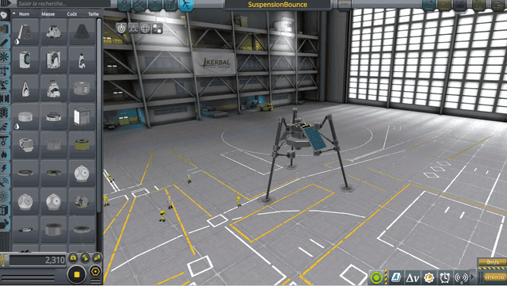
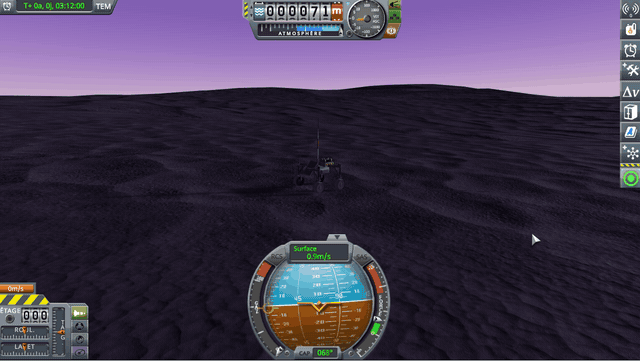
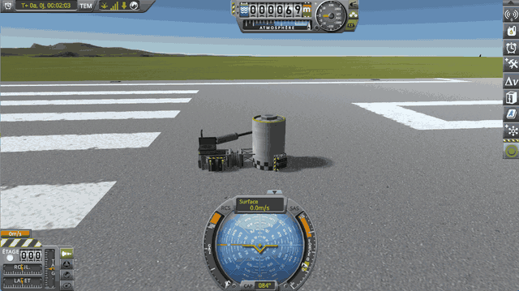

# A damper too strong for a light vessel

Part of [Suspension Bounce Fix](../README.md), [Fixed Tuning](README.md#the-culprits): a culprit in KSP's own setting
of a suspension, which the player's setting replaces.

KSP works a suspension's damper out from its spring alone ([the base model](../how-ksp-sets-a-suspension/the-base-model.md)).
`ModuleWheelSuspension.SuspensionSpringUpdate` turns the weight a wheel carries, `sprungMassGravity`, into a spring,
then the spring into a damper (`springRatio` and `damperRatio` are each part's own):

```csharp
spring = Mathf.Clamp(springTweakable * springRatio * sprungMassGravity * BoostCurve(boost, boostRatio + autoBoost), 0.01f, springClampMax);
damper = Mathf.Sqrt(Mathf.Clamp(spring * damperRatio * damperFudge, 0.01f, damperClampMax)) * damperTweakable;
```

The spring follows the weight; the damper, the square root of the spring. To slow a leg the same whatever its load,
the damper should grow as the mass it slows; it only grows as its square root. It suits a leg carrying about a ton,
and is too strong for one carrying much less.

The [half-ton floor](../how-ksp-sets-a-suspension/the-patches.md#the-half-ton-floor) makes it worse. Whatever its real
share, each wheel is taken to carry at least the weight of half a ton on Kerbin: the `minMass` of
`SuspensionLoadBalancer.FixedUpdate`, which is `0.5`:

```csharp
suspensionModules[j].sprungMassGravity = Mathf.Max((float)(num * (double)share * (double)multiplier), minMass);
```

A leg carrying 33 kg gets the stiffness of a leg carrying half a ton, and the damper that goes with it. For this leg,
the damper is far too strong, and it throws it (see [why a damper can throw a vessel](../damper-bounce/README.md#why-it-matters)):
a probe of 100 kg on three legs is thrown by it as soon as physics starts. A landing leg placed alone in EVA
construction meets it too; the player's setting alone does not settle that one
([A landing leg placed alone](../damper-bounce/checked/a-landing-leg-placed-alone.md)).



*KSP 1.12.5 and KSP Community Fixes, without this mod: the probe of
[A light probe on the runway](checked/a-light-probe-on-the-runway.md), launched from the SPH onto the runway.*

A heavy world makes this culprit worse. On Kerbin, a vessel of a few hundred kilograms stays just short of the edge
where a damper sends the leg back: its damper, the one of the floor's half ton, takes off almost all the leg's speed at
each step, without sending it back. On Eve, the same damper, two to three times as strong
([slider set automatically](../how-ksp-sets-a-suspension/the-patches.md#the-automatic-sliders) and
[high gravity](../how-ksp-sets-a-suspension/the-patches.md#high-gravity)), goes past that edge: a small rover that
stands still on the runway of Kerbin bounces higher and higher on Eve, and never settles. It can hold for a while, its
wheels almost still; at the first disturbance, a bump, a wheel touching the ground again, each step amplifies the
motion once more.



*KSP 1.12.5 and KSP Community Fixes, without this mod: a rover of a quarter of a ton on four RoveMax S2 wheels, set
down on Eve, saved, and loaded there ([A light rover on Eve](checked/a-light-rover-on-eve.md)).*

A light vessel can meet this culprit against another vessel too. A suspension reads how far it has sunk along a ray
cast down the leg's axis, and pushes against whatever that ray meets
([the base model](../how-ksp-sets-a-suspension/the-base-model.md)), the side of a fuel tank as well as the ground.
Swung against a tank, a leg's ray, nearly parallel to the curved side, can meet it already deep inside from one step to
the next: the suspension reads a very fast compression that the leg does not make, and a damper far too strong for a
vessel this light turns it into a push that throws the vessel sideways, often hard enough to break it apart.



*KSP 1.12.5, KSP Community Fixes and Breaking Ground, without this mod: a vessel of 400 kg on the runway swings an
LT-2 landing leg on an F-12 rotation servo against the side of an FL-T400 tank
([A landing leg swung against a fuel tank](checked/a-landing-leg-swung-against-a-fuel-tank.md)).*

## The player's setting

With the player's setting, `SuspensionSpringUpdate` no longer runs for a suspension that has one
([The fix](README.md#the-fix)): no floor, no slider set automatically, no high gravity patch. The damper comes from the
damping ratio and the mass the suspension was set to carry, 2 ζ √(k m), ζ the damping ratio, k the spring, m that
mass: it grows as the mass, and a leg set for 33 kg gets a damper sized for 33 kg, on Kerbin as on Eve. The probe, the
light rover on Eve and the leg swung against a tank come to rest with this setting alone, the mod's other fixes
switched off ([Checking the culprit](README.md#checking-the-culprit)).
