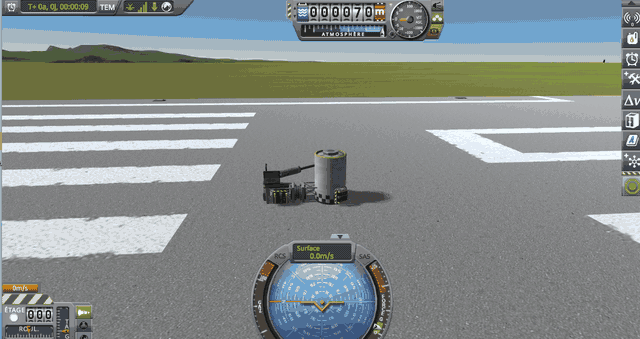

# A landing leg swung against a fuel tank

Part of [Suspension Bounce Fix](../../README.md), [Fixed Tuning](../README.md#checking-the-culprit):
[a damper too strong for a light vessel](../a-damper-too-strong-for-a-light-vessel.md), met on the
side of another vessel.

A part placed alone that rolls against a lander can be pushed off, but only by chance. This setup makes it every
time. It needs the rotation servos of Breaking Ground.

## The save

[saves/SuspensionBounceCulprit3.sfs](../saves/SuspensionBounceCulprit3.sfs) holds two vessels on the runway, docked
together by a pair of Clamp-O-Tron Jr. docking ports:

- `SuspensionBounceCulprit3`: an FL-T400 tank standing upright, with a probe core;
- `SuspensionBounceCulprit3 Probe`, about 400 kg: a probe core, batteries and an F-12 rotation servo, with an LT-2
  landing leg fixed on the servo, lying horizontal, its foot a little away from the FL-T400.

The leg's suspension was never set: without this mod, the game sets it; with it, the mod does, in flight
([Suspensions never set](../README.md#suspensions-never-set)). Copy the save into the folder of a sandbox game, under
`saves`.

## By hand

1. In that game, at the space centre, open the quickload menu (Alt+F9 by default) and load
   `SuspensionBounceCulprit3`.
2. Right-click one of the two docking ports and undock, then switch to `SuspensionBounceCulprit3 Probe` (`]`).
3. Right-click the F-12 servo and set its target angle to 179 (not 180: the slider makes it -179.99, and the
   servo turns the other way): the servo swings the leg until its foot meets the side of the FL-T400, almost
   parallel to it.

*KSP 1.12.5, KSP Community Fixes and this mod: the same save as the GIF without this mod in
[A damper too strong for a light vessel](../a-damper-too-strong-for-a-light-vessel.md).*

Without this mod, the light vessel is thrown sideways the moment the foot touches, much harder than the swing of the
leg can explain; not at every try, but a few tries are enough, and it can be thrown hard enough to break apart. With
this mod, it is pushed aside and comes to rest, undamaged. The GIF with this mod was filmed with an earlier build.

It is not perfect: the suspension still takes the side of the tank for ground, and compresses against it where a real
leg would just knock against the tank. Its ray, nearly parallel to the curved side, can meet it already deep inside
from one step to the next: the suspension reads a very fast compression that the leg does not make, and its damper
pushes back against it. The vessel still gets a kick whenever the foot meets the tank, but no longer one that breaks
it apart. The ground, broad and smooth, does not do this.

## By script

[run-tank-graze.py](../run-tank-graze.py) plays these steps several times in a
row, through [KSP-Util-MCPServer](https://github.com/lhervier/KSP-Util-MCPServer); its first lines say how to run it.

    python run-tank-graze.py --folder <your sandbox game> --trials 10 --out out

It prints, for each trial, the top speed of the light vessel over the ground, as the navball shows it, and its parts
before and after.

Played without [Parking Brake](https://github.com/jarosm/KSP-ParkingBrake), which this mod is not compatible with,
KSP 1.12.5, KSP Community Fixes, Breaking Ground,
[Terrain Precision Fix](https://github.com/lhervier/KSP-Fix-TerrainPrecision),
[KSP-Fix-AutoStrut](https://github.com/lhervier/KSP-Fix-AutoStrut) and
[Physics Easing Fix](https://github.com/lhervier/KSP-Fix-PhysicsEasing): ten times in a row without this mod; twenty
times with this mod and its default settings; and twenty times with Fixed Tuning alone, `damperBounce = false` and
`endStopSlide = false` in the mod's `settings.cfg`:

| | Without this mod | Fixed Tuning alone | This mod |
|---|---|---|---|
| Broke apart | 3 of 10 | 0 of 20 | 0 of 20 |
| Top speed over the ground: median | 2.1 m/s | 2.3 m/s | 2.3 m/s |
| Top speed over the ground: lowest to highest | 1.5 to 13.5 m/s | 2.1 to 3.3 m/s | 2.0 to 3.5 m/s |

Fixed Tuning alone gives the same as the whole mod: the mod's other fixes change nothing here. Played earlier with KSP
1.12.5, KSP Community Fixes and Breaking Ground only, the light vessel broke apart seven times out of ten without this
mod.
