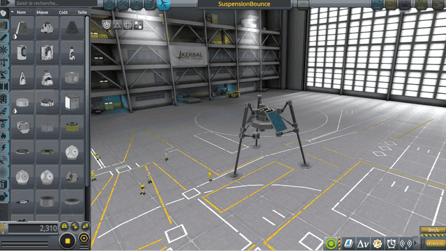
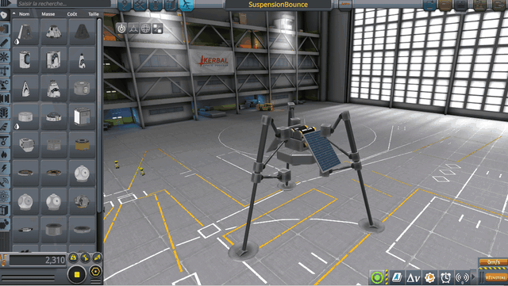

# A light probe on the runway

Part of [Suspension Bounce Fix](../../README.md), [Fixed Tuning](../README.md#checking-the-culprit):
[a damper too strong for a light vessel](../a-damper-too-strong-for-a-light-vessel.md).

## The craft

[saves/SuspensionBounce.craft](../saves/SuspensionBounce.craft): an OKTO2 probe core, three LT-05 micro landing
struts, a Z-100 battery and two OX-STAT solar panels, about 100 kg in all, so about 33 kg per leg. Copy it into
`Ships/SPH` of a sandbox game. Its suspensions were never set: with this mod, launched as it is, they are set at the
first physics step, from the probe's mass shared equally among its legs
([Suspensions never set](../README.md#suspensions-never-set)).

## By hand

Launch the craft on the runway, and watch the altimeter. With this mod, a launch from the SPH first stops on
*Suspensions not set*: answer *Launch as they are*.

<table>
<tr>
<td width="50%"></td>
<td width="50%"></td>
</tr>
<tr>
<td valign="top"><em>KSP 1.12.5 and KSP Community Fixes: the probe, launched from the SPH onto the runway.</em></td>
<td valign="top"><em>KSP 1.12.5, KSP Community Fixes and this mod, the game setting the springs: the same.</em></td>
</tr>
</table>

Without this mod, the probe leaves the runway the moment physics starts: the altimeter, which reads 70 m on the
runway, goes above 230 m, then the probe falls back, bounces up again, and so on. Putting it back on the ground by any
other means (the *Set Position* tool of the debug menu, for one) ends the same way. With this mod, the probe settles
on its legs within a fraction of a second, and stays there.

## By script

[diag/automation/check.py](../../diag/automation/check.py) launches the craft through
[KSP-Util-MCPServer](https://github.com/lhervier/KSP-Util-MCPServer) and records
[KSP Diag - Suspension](https://github.com/lhervier/KSP-Diag-Suspension) for 20 s; it then folds the legs and deploys
them again (`--no-legs` leaves them be), which the table below leaves out. Its first lines say how to run it:

    python check.py probe --folder <your sandbox game> --trials 3 --label stock

Played once without this mod, KSP 1.12.5 and KSP Community Fixes; with this mod, three times with its default
settings, and three times with Fixed Tuning alone, `damperBounce = false` and `endStopSlide = false` in the mod's
`settings.cfg`:

| | Without this mod | Fixed Tuning alone | This mod |
|---|---|---|---|
| Time with no leg on the ground | 99 % | 0 | 0 |
| Top speed over the ground | 66 m/s | 0.13 m/s | 0.13 m/s |
| Parts at the end | 0 of 7 | 7 of 7 | 7 of 7 |
| `KSP.log` | `batteryPack`, `solarPanels5` (twice), `probeCoreOcto2.v2` `Exploded!!` | nothing | nothing |

Fixed Tuning alone keeps the probe on its legs: the mod's other fixes change nothing here.
